<p align="center">
  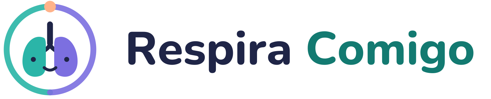
</p>

<p align="center"><b>Aprenda o caminho do ar. Respire no seu ritmo.</b></p>

<p align="center">
  
  
  
</p>

<p align="center">
  🌐 <a href="https://enzorossi11.github.io/respira-comigo/"><b>Abrir o app</b></a> ·
  🎬 <a href="docs/demo.mp4"><b>Vídeo de demonstração</b></a> ·
  📍 <a href="docs/roteiro.md"><b>Roteiro do projeto</b></a>
</p>

<p align="center">
  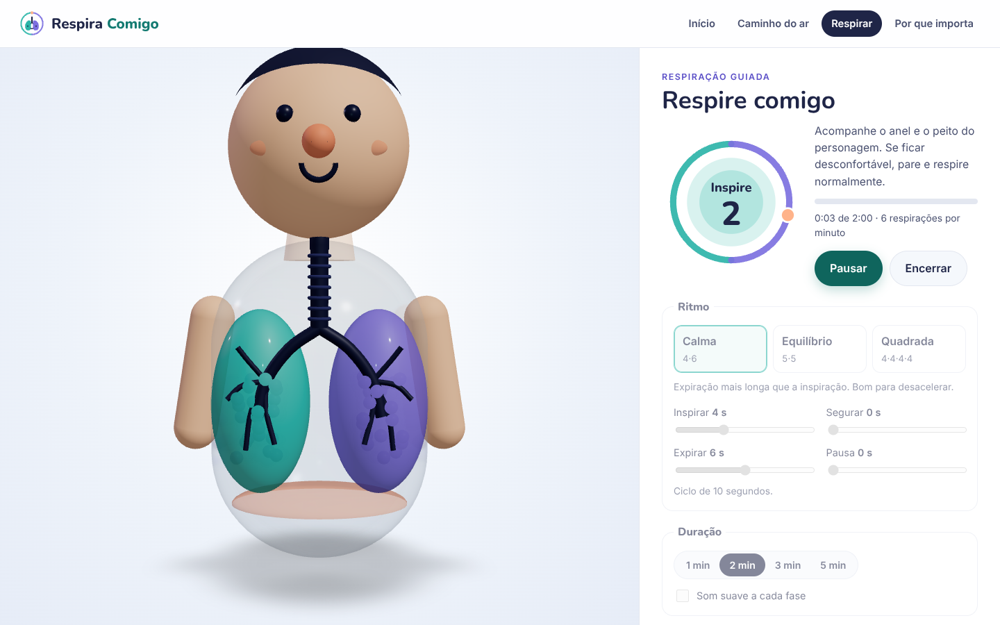
</p>

---

## Sumário

1. [Sobre o projeto](#1-sobre-o-projeto)
2. [Descrição do problema](#2-descrição-do-problema)
3. [Solução](#3-solução)
4. [Protótipo](#4-protótipo)
5. [Como executar](#5-como-executar)
6. [Tecnologias e decisões técnicas](#6-tecnologias-e-decisões-técnicas)
7. [Identidade visual](#7-identidade-visual)
8. [Pitch](#8-pitch)
9. [Cronograma e evolução](#9-cronograma-e-evolução)
10. [Estrutura do repositório](#10-estrutura-do-repositório)
11. [Equipe](#11-equipe)
12. [Referências](#12-referências)

---

## 1. Sobre o projeto

**Título:** Respira Comigo
**Tema:** Sistema respiratório · Saúde e Bem-Estar (ODS 3)

O **Respira Comigo** é uma aplicação web em que um **personagem 3D** mostra, de forma animada, o **caminho que o ar percorre** no corpo — do nariz até os alvéolos — e, em seguida, **conduz o usuário em uma respiração guiada**, com o peito do personagem se expandindo e contraindo no ritmo escolhido.

> **MVP:** caminho do ar em 3 etapas + respiração guiada com ritmo ajustável. ✅ Funcionando.

---

## 2. Descrição do problema

### 2.1 O problema

Adolescentes brasileiros convivem com níveis altos de **ansiedade, preocupação e irritabilidade**, e têm pouco acesso a apoio dentro da escola. Ao mesmo tempo, a **respiração** — uma das ferramentas mais simples e acessíveis de autorregulação — costuma ser ensinada só como conteúdo de prova (nomes de órgãos para decorar), sem ligação com o próprio bem-estar.

Resultado: o aluno estuda o sistema respiratório, mas não aprende a **usar a própria respiração** a seu favor.

### 2.2 Por que importa (dados)

Todos os números abaixo foram extraídos das planilhas oficiais pelos scripts em [`data/`](data/README.md) e aparecem no próprio app, com a fonte.

| Indicador (estudantes de 13 a 17 anos, Brasil) | 2024 | Fonte |
|---|---|---|
| Muito preocupados com as coisas comuns do dia a dia | **49,7%** | IBGE, PeNSE 2024, Tab. 12.2.1 |
| Irritados, nervosos ou mal-humorados por qualquer coisa | **42,9%** | IBGE, PeNSE 2024, Tab. 12.5.1 |
| Tristes na maioria das vezes ou sempre | **28,9%** | IBGE, PeNSE 2024, Tab. 12.3.1 |
| Autoavaliação de saúde mental negativa | **14,9%** (meninas 22,9% · meninos 6,8%) | IBGE, PeNSE 2024, Tab. 12.7.1 |
| Em escolas com profissional de saúde mental no quadro | **34,1%** | IBGE, PeNSE 2024, Tab. 19.14.1 |

E mais:

- O Brasil tem a maior prevalência de transtornos de ansiedade do mundo: **9,3%** da população (OMS, 2017).
- As internações no SUS por doenças do aparelho respiratório entre crianças de 5 a 9 anos passaram de **≈90 mil (2019)** para **≈130 mil (2024)** (DATASUS, SIH/SUS).

### 2.3 Público e contexto

- **Público principal:** estudantes de **11 a 17 anos** (anos finais do Ensino Fundamental e Ensino Médio), faixa em que o sistema respiratório é conteúdo escolar e em que a PeNSE mostra sinais de sofrimento emocional.
- **Público secundário:** **professores de Ciências/Biologia** (usam o app em aula) e **orientadores/psicólogos escolares** (usam a respiração guiada em momentos de acolhimento).
- **Contexto de uso:** sala de aula, laboratório de informática, celular do aluno antes de provas e apresentações, ou em casa.

### 2.4 Delimitação

O Respira Comigo **não é tratamento** e **não substitui atendimento** de saúde mental. Ele atua em **educação em saúde e autocuidado**: ensinar como a respiração funciona e oferecer uma prática simples de respiração lenta. O app mostra, no rodapé de todas as telas, onde buscar ajuda (UBS, CAPS, CVV 188).

### 2.5 Bases de dados públicas

| Base | Responsável | O que usamos |
|---|---|---|
| **PeNSE 2019 e 2024** | IBGE | Indicadores de saúde mental dos estudantes e suporte psicológico na escola ([tabelas oficiais](https://ftp.ibge.gov.br/pense/)) |
| **SIH/SUS** | DATASUS / Ministério da Saúde | Internações por doenças do aparelho respiratório (CID-10, cap. X), 5 a 19 anos, 2015–2024 ([TabNet](http://tabnet.datasus.gov.br/cgi/tabcgi.exe?sih/cnv/nrbr.def)) |
| **Global Health Estimates** | OMS | Prevalência de ansiedade no Brasil ([publicação](https://www.who.int/publications/i/item/depression-global-health-estimates)) |

Detalhes, tabelas exatas e como gerar os dados de novo: [`data/README.md`](data/README.md).

---

## 3. Solução

O app une **aprender** e **praticar** em uma experiência curta (3 a 5 minutos):

```
 1. APRENDER                        2. PRATICAR                       3. ENTENDER
 Caminho do ar em 3 etapas   ──►    Respiração guiada            ──►  Por que isso importa
 (personagem 3D animado)            (ritmo ajustável)                 (painel com dados reais)
```

1. **Caminho do ar:** em cada etapa, a câmera se aproxima das partes do corpo, elas ficam destacadas com rótulos e as partículas de ar que estão naquele trecho brilham.
   - **Etapa 1:** nariz, faringe e laringe
   - **Etapa 2:** traqueia e brônquios
   - **Etapa 3:** pulmões, alvéolos e diafragma
2. **Respiração guiada:** três ritmos prontos (**Calma 4·6**, **Equilíbrio 5·5**, **Quadrada 4·4·4·4**) ou ajuste livre de inspirar, segurar, expirar e pausa. Os pulmões e o peito do personagem enchem e esvaziam no ritmo, as partículas de ar entram e saem pelo caminho aprendido, e o anel (o mesmo do logo) marca a fase e a contagem. Tem som suave opcional, duração de 1 a 5 minutos, pausa e fim automático.
3. **Por que importa:** cards e gráficos com os dados oficiais, cada um com a fonte e o link.

**Por que respiração lenta:** revisões de estudos associam a respiração lenta e controlada (≈6 ciclos por minuto) a mais relaxamento e menos ansiedade (Zaccaro et al., 2018). Todos os ritmos prontos do app ficam em 6 respirações por minuto ou menos.

---

## 4. Protótipo

🎬 **[Vídeo de demonstração (1min40)](docs/demo.mp4)**: o fluxo principal completo, do início ao painel de dados.

| Início | Etapa 1 – Nariz, faringe e laringe |
|---|---|
| 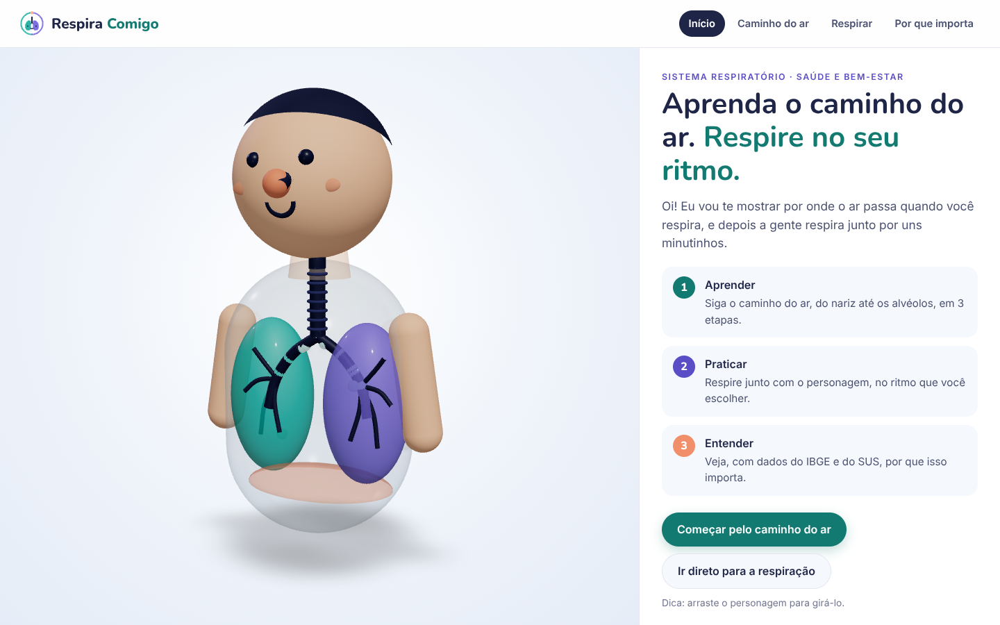 | 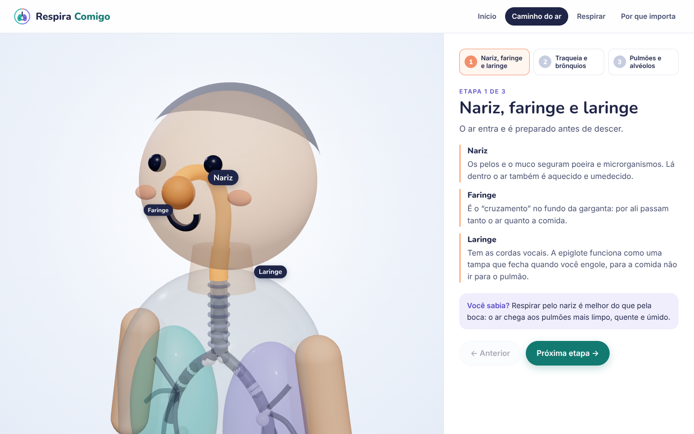 |
| **Etapa 2 – Traqueia e brônquios** | **Etapa 3 – Pulmões e alvéolos** |
| 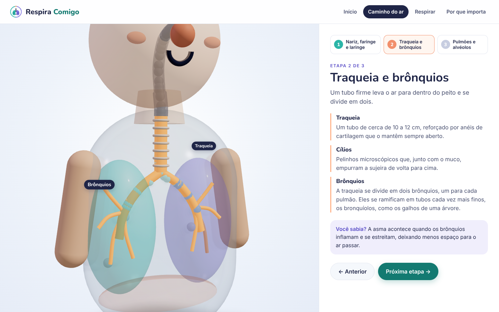 | 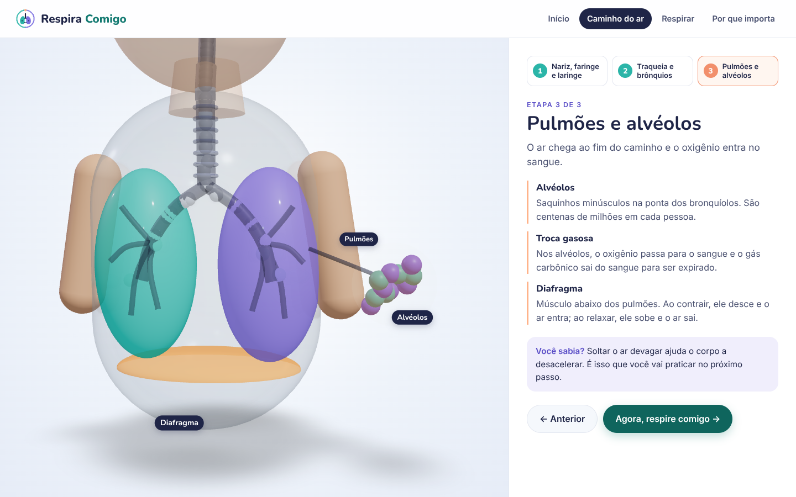 |
| **Respiração guiada – inspirando** | **Respiração guiada – soltando o ar** |
|  | 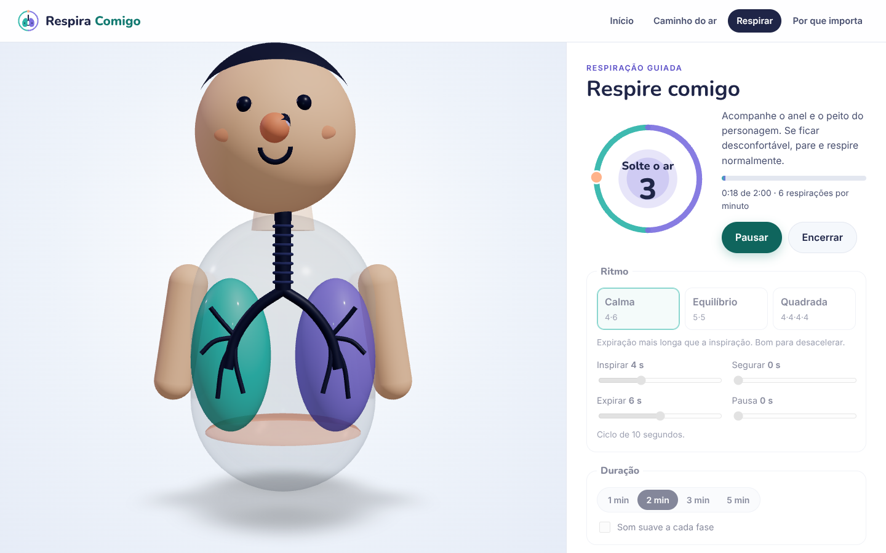 |

<details>
<summary><b>Painel de dados e versão para celular</b></summary>

| Por que importa | Celular |
|---|---|
| 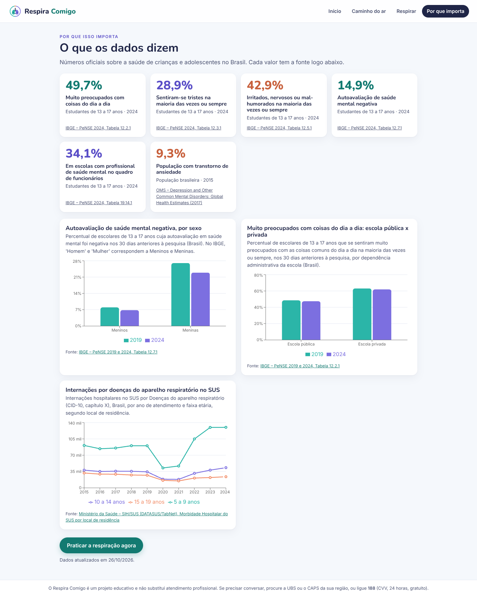 | 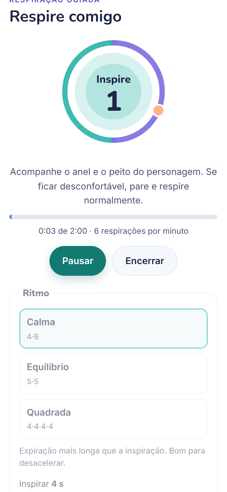 |

</details>

---

## 5. Como executar

### Online

O app é publicado automaticamente em **https://enzorossi11.github.io/respira-comigo/** a cada atualização da branch `main`.

### No seu computador

Pré-requisito: [Node.js](https://nodejs.org/) 20 ou mais recente.

```bash
git clone https://github.com/enzorossi11/respira-comigo.git
cd respira-comigo/app
npm install
npm run dev
```

Abra o endereço que aparecer no terminal (normalmente http://localhost:5173).

| Comando (dentro de `app/`) | O que faz |
|---|---|
| `npm run dev` | Abre o app em modo de desenvolvimento |
| `npm test` | Roda os 19 testes automáticos |
| `npm run build` | Gera a versão de produção em `app/dist/` |
| `npm run preview` | Abre a versão de produção localmente |

### Gerar os dados de novo (opcional)

Os dados tratados já estão no repositório (`data/processed/indicadores.json`). Para baixar tudo de novo das fontes oficiais, com Python 3.10 ou mais recente:

```bash
pip install -r data/requirements.txt
python3 data/scripts/baixar_pense.py
python3 data/scripts/baixar_sih.py
python3 data/scripts/gerar_json.py
```

---

## 6. Tecnologias e decisões técnicas

| Camada | Tecnologia | Uso no projeto |
|---|---|---|
| Interface | **React 19 + TypeScript + Vite** | Telas, navegação e controles de ritmo |
| 3D | **Three.js** via **React Three Fiber** + **drei** | Personagem, vias aéreas, pulmões, diafragma e partículas de ar |
| Estado | **Zustand** | Tela atual, etapa, ritmo e sessão de respiração |
| Gráficos | **Recharts** | Painel “Por que importa” |
| Som | **Web Audio API** | Sinais suaves gerados na hora, sem arquivos de áudio |
| Fontes | **Nunito + Inter** (Fontsource) | Servidas junto com o app, sem depender do Google |
| Dados | **Python + pandas** | Download e tratamento da PeNSE e do SIH/SUS → JSON |
| Testes | **Vitest** | Lógica da respiração e integridade dos dados |
| Entrega | **GitHub Actions + GitHub Pages** | Testa, compila e publica a cada push na `main` |

**Decisões principais**

- **Web, e não app nativo:** abre em qualquer navegador — computador da escola, Chromebook ou celular —, sem instalação.
- **Personagem modelado em código:** o corpo e a anatomia são formas do Three.js (esferas, cápsulas e tubos que seguem curvas). Isso deixou o 3D leve, fácil de animar no ritmo da respiração e de destacar parte por parte, sem depender de um modelo externo. A geometria do caminho do ar fica em [`app/src/3d/anatomia.ts`](app/src/3d/anatomia.ts).
- **Lógica da respiração separada da interface:** [`app/src/lib/respiracao.ts`](app/src/lib/respiracao.ts) é uma função pura que, dado o tempo e o ritmo, diz a fase, a contagem e quanto os pulmões estão cheios. O anel, o personagem e as partículas leem dela, então tudo fica sincronizado, e ela é coberta por testes.
- **Animação sem re-render:** o 3D lê o estado direto no `useFrame`, sem re-renderizar o React a cada quadro, o que mantém a animação fluida.
- **Carregamento em partes:** a cena 3D e o painel de dados são carregados separadamente, para a primeira tela abrir rápido.
- **Sem backend e sem cadastro:** os dados públicos viram um JSON estático no momento do build. As preferências (ritmo, duração, som) ficam só no navegador do aluno. Nenhum dado pessoal é coletado (LGPD).
- **Conteúdo sensível filtrado:** por ser voltado a adolescentes, o app não lê nem exibe os indicadores da PeNSE sobre autolesão e ideação suicida.
- **Acessibilidade:** navegação por teclado (setas trocam de etapa), rótulos para leitores de tela e contraste de texto seguindo o guia de marca.

---

## 7. Identidade visual

Guia completo: [`docs/identidade-visual.md`](docs/identidade-visual.md)

| Versão principal | Ícone | Fundo escuro |
|---|---|---|
|  | 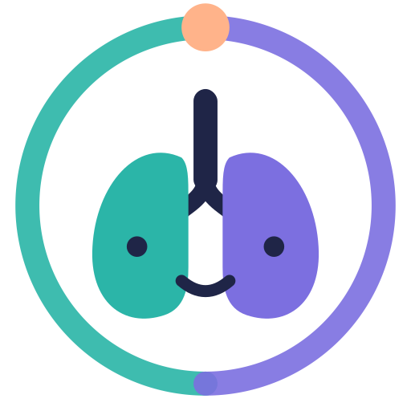 | 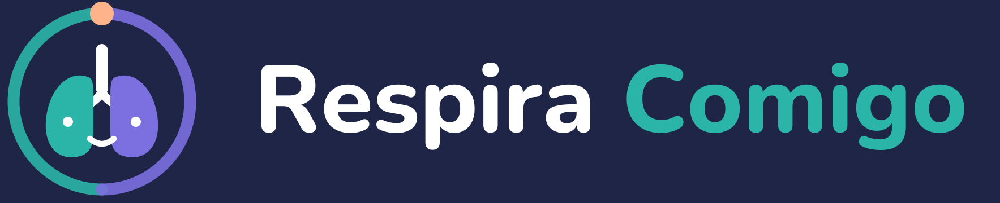 |

**Conceito:** dois pulmões com um rosto simpático (o personagem) dentro de um **anel de respiração**. A metade verde do anel é a **inspiração**, a metade lilás é a **expiração**, e o ponto pêssego marca o **ritmo**. No app, esse mesmo anel guia a respiração.

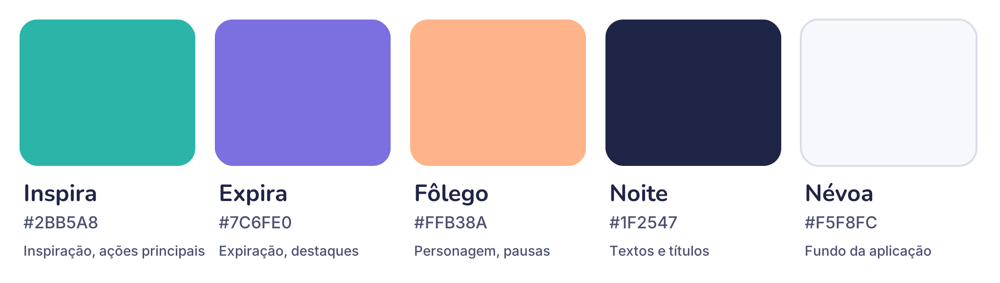

| Nome | HEX | Uso |
|---|---|---|
| Inspira | `#2BB5A8` | Inspiração, pulmão direito |
| Inspira escuro | `#137A71` | Botões e texto em verde (contraste acessível) |
| Expira | `#7C6FE0` | Expiração, pulmão esquerdo |
| Fôlego | `#FFB38A` | Pausas, marcador de ritmo, destaques |
| Noite | `#1F2547` | Textos e títulos |
| Névoa | `#F5F8FC` | Fundo da aplicação |


- **Títulos:** Nunito ExtraBold · **Textos:** Inter Regular/SemiBold (licença OFL)

---

## 8. Pitch

> O Brasil é o país com maior prevalência de ansiedade do mundo, e metade dos nossos estudantes de 13 a 17 anos diz se sentir muito preocupada com as coisas do dia a dia — mas só um terço estuda numa escola com profissional de saúde mental. A respiração é a ferramenta de autorregulação mais simples que existe, e mesmo assim a escola a ensina apenas como nomes de órgãos para decorar. O **Respira Comigo** muda isso: um personagem 3D mostra o caminho do ar do nariz aos alvéolos e, logo em seguida, respira junto com o aluno, no ritmo que ele escolher.
>
> **Diferencial:** une, em uma única experiência de poucos minutos, o **conteúdo de Ciências** e a **prática de bem-estar**. Roda no navegador, sem instalação e sem cadastro, e é baseado em dados públicos reais sobre a saúde dos estudantes brasileiros.

Roteiro do pitch final de 5 minutos, plano B e perguntas prováveis da banca: [`docs/pitch.md`](docs/pitch.md).

---

## 9. Cronograma e evolução

| Período | Entrega | Status |
|---|---|---|
| 19/10 a 23/10 | **Checkpoint 1** – problema, tecnologias, identidade visual e pitch inicial | ✅ |
| 09/11 a 13/11 | **Checkpoint 2** – protótipo funcional, GitHub documentado e vídeo | ✅ |
| 07/12 e 08/12 | **Apresentação final** – pitch de 5 min, projeto funcionando e repositório final | ⏳ |

**Do Checkpoint 1 para o 2**

- O MVP planejado (3 etapas + ritmo ajustável) está completo e navegável, com **dados reais** no lugar de dados mockados.
- O personagem passou a ser modelado direto em código, em vez de um modelo do Blender (ver seção 6).
- Os dados do SUS vêm do TabNet, consultado por script, no lugar da biblioteca PySUS, que exigiria o FTP do DATASUS.
- Entraram também: duração da sessão, som opcional, fim automático, contador de sessões, versão para celular, testes e publicação automática.

**Próximos passos (até a apresentação final):** incorporar os retornos do Professor Mentor, modo professor (projetar em sala), narração em áudio e testes com alunos.

---

## 10. Estrutura do repositório

```
respira-comigo/
├── README.md
├── .github/workflows/deploy.yml   ← testa, compila e publica no GitHub Pages
├── app/                           ← aplicação (React + Three.js)
│   └── src/
│       ├── 3d/                    ← cena, personagem, anatomia e partículas de ar
│       ├── telas/                 ← Início, Caminho do ar, Respirar, Por que importa
│       ├── componentes/           ← anel de respiração
│       ├── conteudo/etapas.ts     ← textos das 3 etapas
│       ├── lib/respiracao.ts      ← lógica da respiração (+ testes)
│       └── store.ts               ← estado do app
├── data/
│   ├── scripts/                   ← download e tratamento (PeNSE e SIH/SUS)
│   ├── processed/                 ← JSON e CSVs usados pelo app
│   └── README.md                  ← de onde vem cada número
├── assets/                        ← logo, paleta e tipografia
└── docs/
    ├── prints/                    ← capturas de tela do protótipo
    ├── demo.mp4                   ← vídeo de demonstração
    ├── pitch.md                   ← pitch inicial e roteiro do pitch final
    ├── identidade-visual.md
    ├── bases-de-dados.md
    └── roteiro.md                 ← o que está pronto e próximos passos
```

---

## 11. Equipe

| Integrante | GitHub | Responsabilidade principal |
|---|---|---|
| Enzo Rossi | [@enzorossi11](https://github.com/enzorossi11) | Gestão do projeto, problema e dados |
| _Nome_ | [@usuario](https://github.com/usuario) | _Front-end e 3D_ |
| _Nome_ | [@usuario](https://github.com/usuario) | _Identidade visual e personagem_ |
| _Nome_ | [@usuario](https://github.com/usuario) | _Dados (PeNSE / DATASUS)_ |

> Cada integrante faz commits pela própria conta, em branch própria (`feat/nome-da-tarefa`), com Pull Request para a `main`.

---

## 12. Referências

- IBGE. **Pesquisa Nacional de Saúde do Escolar – PeNSE 2019** e **PeNSE 2024**. Rio de Janeiro: IBGE.
- Ministério da Saúde. **DATASUS – Sistema de Informações Hospitalares do SUS (SIH/SUS)**, TabNet.
- WORLD HEALTH ORGANIZATION. **Depression and Other Common Mental Disorders: Global Health Estimates**. Genebra: WHO, 2017.
- ZACCARO, A. et al. How breath-control can change your life: a systematic review on psycho-physiological correlates of slow breathing. **Frontiers in Human Neuroscience**, v. 12, 2018.
- ONU Brasil. **Objetivo de Desenvolvimento Sustentável 3 – Saúde e Bem-Estar**.

---

<sub>O Respira Comigo é um projeto acadêmico de educação em saúde. Não substitui avaliação ou tratamento profissional. Se precisar conversar, procure a UBS ou o CAPS da sua região, ou ligue para o CVV (188).</sub>
