<p align="center">
  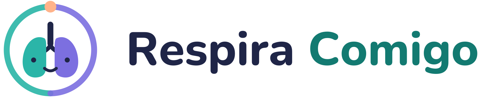
</p>

<p align="center"><b>Aprenda o caminho do ar. Jogue. Respire no seu ritmo.</b></p>

<p align="center">
  
  
</p>

<p align="center">
  <a href="https://enzorossi11.github.io/respira-comigo/"><b>Abrir o app</b></a> ·
  <a href="docs/demo.mp4"><b>Vídeo de demonstração</b></a>
</p>

<p align="center">
  <a href="docs/demo.mp4">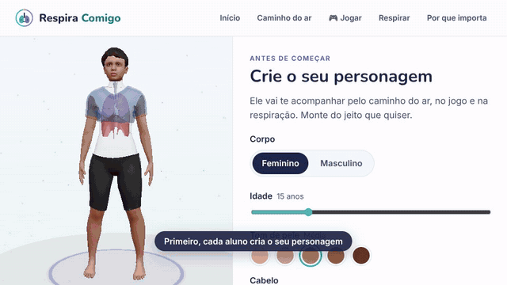</a>
</p>

---

## Sumário

1. [Sobre o projeto](#1-sobre-o-projeto)
2. [Descrição do problema](#2-descrição-do-problema)
3. [Solução](#3-solução)
4. [Protótipo](#4-protótipo)
5. [Como executar](#5-como-executar)
6. [Tecnologias](#6-tecnologias)
7. [Identidade visual](#7-identidade-visual)
8. [Pitch](#8-pitch)
9. [Cronograma](#9-cronograma)
10. [Estrutura do repositório](#10-estrutura-do-repositório)
11. [Equipe](#11-equipe)
12. [Referências](#12-referências)

---

## 1. Sobre o projeto

**Título:** Respira Comigo
**Tema:** Sistema respiratório · Saúde e Bem-Estar (ODS 3)
**Equipe:** Enzo Rossi, Mariane Paiva, Maria Eduarda Morais e Gleicy Crispim

O Respira Comigo é uma aplicação web em que um personagem 3D mostra o caminho que o ar percorre no corpo, do nariz até os alvéolos, e depois respira junto com o usuário, num ritmo escolhido por ele. O conteúdo também vira um jogo, em que o aluno guia uma molécula de oxigênio por dentro das vias aéreas.

**MVP:** caminho do ar em 3 etapas e respiração guiada com ritmo ajustável.

---

## 2. Descrição do problema

### 2.1 O problema

Adolescentes brasileiros convivem com níveis altos de ansiedade, preocupação e irritabilidade, e têm pouco apoio para lidar com isso dentro da escola. Ao mesmo tempo, a respiração, uma das formas mais simples de autorregulação, costuma ser ensinada apenas como conteúdo de prova, com nomes de órgãos para decorar e sem relação com o bem-estar do próprio aluno.

O aluno estuda o sistema respiratório, mas não aprende a usar a respiração a seu favor.

### 2.2 Dados

Os números abaixo foram extraídos das tabelas oficiais pelos scripts da pasta [`data/`](data/README.md) e também aparecem no app, com a fonte.

| Indicador (estudantes de 13 a 17 anos, Brasil) | 2024 | Fonte |
|---|---|---|
| Muito preocupados com as coisas comuns do dia a dia | **49,7%** | IBGE, PeNSE 2024, Tab. 12.2.1 |
| Irritados, nervosos ou mal-humorados por qualquer coisa | **42,9%** | IBGE, PeNSE 2024, Tab. 12.5.1 |
| Tristes na maioria das vezes ou sempre | **28,9%** | IBGE, PeNSE 2024, Tab. 12.3.1 |
| Autoavaliação de saúde mental negativa | **14,9%** (meninas 22,9%, meninos 6,8%) | IBGE, PeNSE 2024, Tab. 12.7.1 |
| Em escolas com profissional de saúde mental no quadro | **34,1%** | IBGE, PeNSE 2024, Tab. 19.14.1 |

Além disso, o Brasil tem a maior prevalência de transtornos de ansiedade do mundo, 9,3% da população (OMS, 2017), e as internações no SUS por doenças do aparelho respiratório entre crianças de 5 a 9 anos passaram de cerca de 90 mil em 2019 para cerca de 130 mil em 2024 (DATASUS, SIH/SUS).

### 2.3 Público e contexto

- **Público principal:** estudantes de 11 a 17 anos (anos finais do Ensino Fundamental e Ensino Médio), fase em que o sistema respiratório é conteúdo escolar e em que a PeNSE mostra sinais de sofrimento emocional.
- **Público secundário:** professores de Ciências e Biologia, que podem usar o app em aula, e orientadores ou psicólogos escolares, que podem usar a respiração guiada em momentos de acolhimento.
- **Contexto de uso:** sala de aula, laboratório de informática, em casa ou no celular, antes de uma prova ou apresentação.

### 2.4 Delimitação

O Respira Comigo não é tratamento e não substitui atendimento de saúde mental. A proposta é de educação em saúde e autocuidado: ensinar como a respiração funciona e oferecer uma prática simples de respiração lenta. O rodapé de todas as telas indica onde buscar ajuda (UBS, CAPS e CVV 188).

### 2.5 Bases de dados públicas

| Base | Responsável | Uso no projeto |
|---|---|---|
| **PeNSE 2019 e 2024** | IBGE | Indicadores de saúde mental dos estudantes e presença de profissional de saúde mental na escola ([tabelas oficiais](https://ftp.ibge.gov.br/pense/)) |
| **SIH/SUS** | DATASUS / Ministério da Saúde | Internações por doenças do aparelho respiratório (CID-10, cap. X), de 5 a 19 anos, 2015 a 2024 ([TabNet](http://tabnet.datasus.gov.br/cgi/tabcgi.exe?sih/cnv/nrbr.def)) |
| **Global Health Estimates** | OMS | Prevalência de ansiedade no Brasil ([publicação](https://www.who.int/publications/i/item/depression-global-health-estimates)) |

Mais detalhes sobre as bases e as tabelas usadas: [`docs/bases-de-dados.md`](docs/bases-de-dados.md) e [`data/README.md`](data/README.md).

---

## 3. Solução

A experiência leva de 5 a 8 minutos e tem cinco partes:

1. **Criação do personagem.** No primeiro acesso, o aluno escolhe corpo (feminino ou masculino), idade, tom de pele e cabelo, e o personagem muda na hora. A ideia é que o aluno se reconheça no personagem e veja o caminho do ar num corpo parecido com o dele. O biotipo não é uma opção, para não abrir espaço para comparação de corpo. As escolhas ficam salvas só no navegador.
2. **Caminho do ar.** Em três etapas, a câmera se aproxima de cada parte do corpo, que aparece destacada e com nome:
   - nariz, faringe e laringe;
   - traqueia e brônquios;
   - pulmões, alvéolos e diafragma.
3. **Jornada do ar (jogo).** O aluno é uma molécula de oxigênio: entra pela narina do personagem e precisa chegar até um alvéolo. Cada trecho tem um obstáculo ligado ao conteúdo, como pelos no nariz, a epiglote na laringe, cílios e vírus na traqueia e bronquíolos cada vez mais finos. Ao bater, o jogo explica o que aconteceu, por exemplo: "Pólen! É ele que causa alergia".
4. **Respiração guiada.** Três ritmos prontos (Calma 4·6, Equilíbrio 5·5 e Quadrada 4·4·4·4) ou ajuste livre. Os pulmões do personagem enchem e esvaziam no ritmo escolhido, e um anel marca cada fase. No modo **Desafio de ritmo**, o aluno segura um botão enquanto inspira e solta enquanto expira, e ganha pontos por acompanhar o ritmo.
5. **Por que importa.** Painel com os dados oficiais que fundamentam o problema, cada um com a fonte.

A escolha pela respiração lenta se apoia em estudos de revisão que associam a respiração controlada, em torno de 6 ciclos por minuto, a mais relaxamento e menos ansiedade (Zaccaro et al., 2018). Todos os ritmos prontos do app ficam nessa faixa.

---

## 4. Protótipo

[Vídeo de demonstração (2 min)](docs/demo.mp4)

| Criação do personagem | Outra combinação |
|---|---|
| 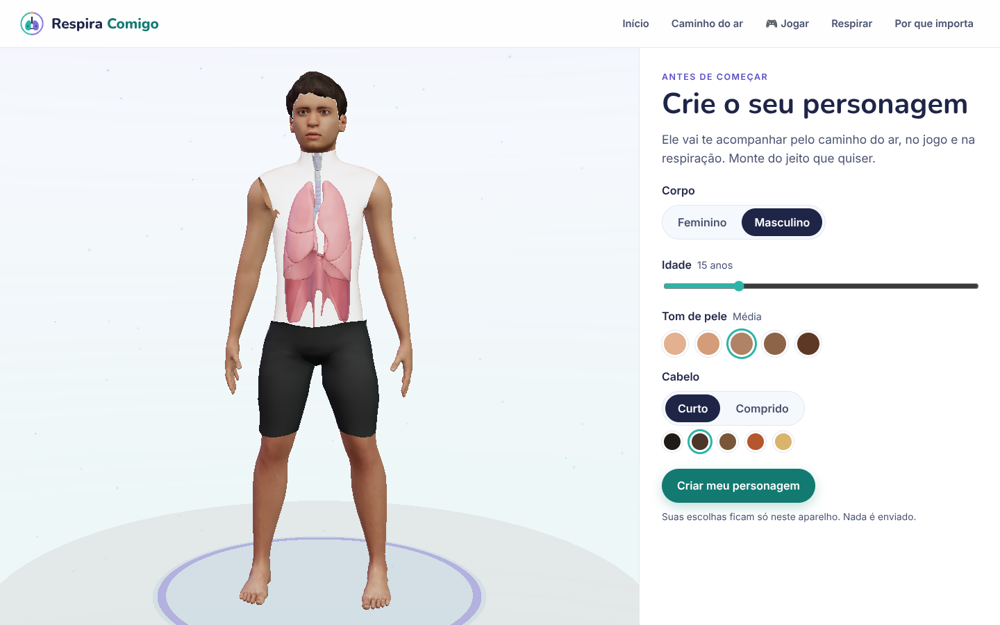 | 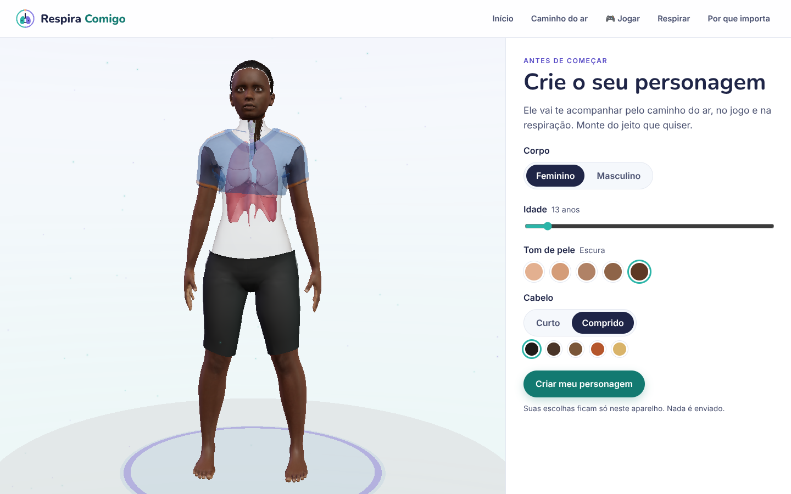 |
| **Início** | **Etapa 1: nariz, faringe e laringe** |
| 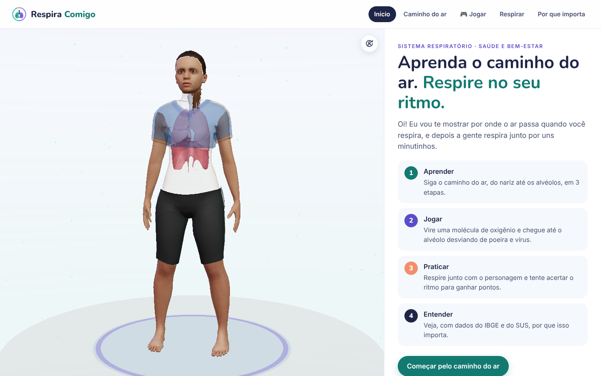 | 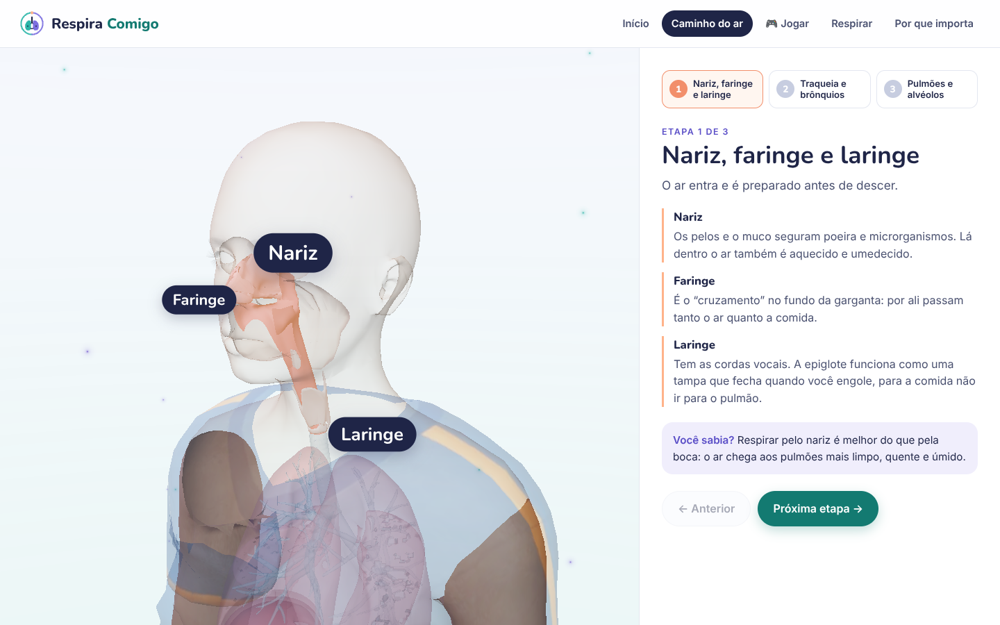 |
| **Etapa 2: traqueia e brônquios** | **Etapa 3: pulmões e alvéolos** |
| 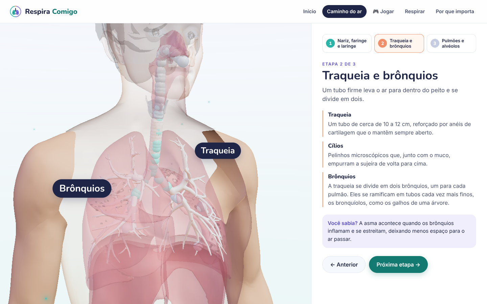 | 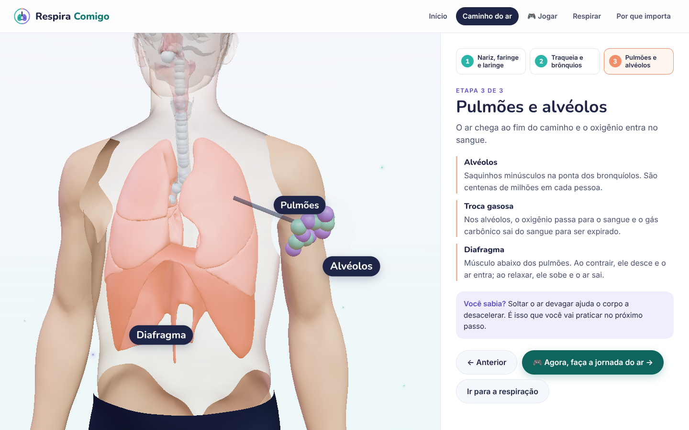 |
| **Jogo: entrada pela narina** | **Jogo: traqueia** |
| 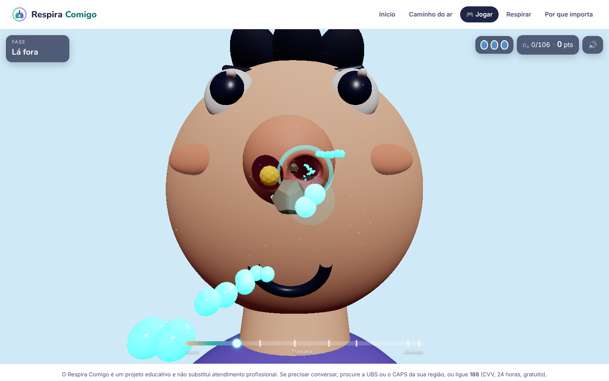 | 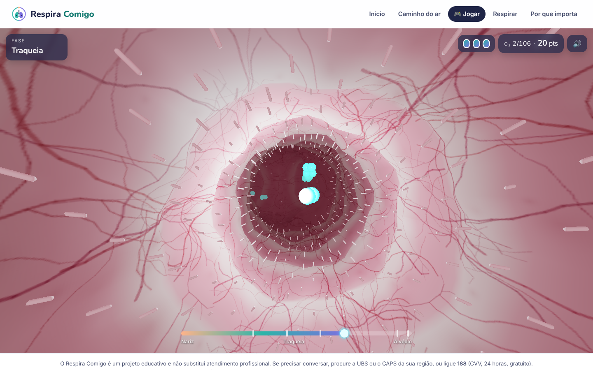 |
| **Jogo: escolha do pulmão** | **Jogo: chegada ao alvéolo** |
| 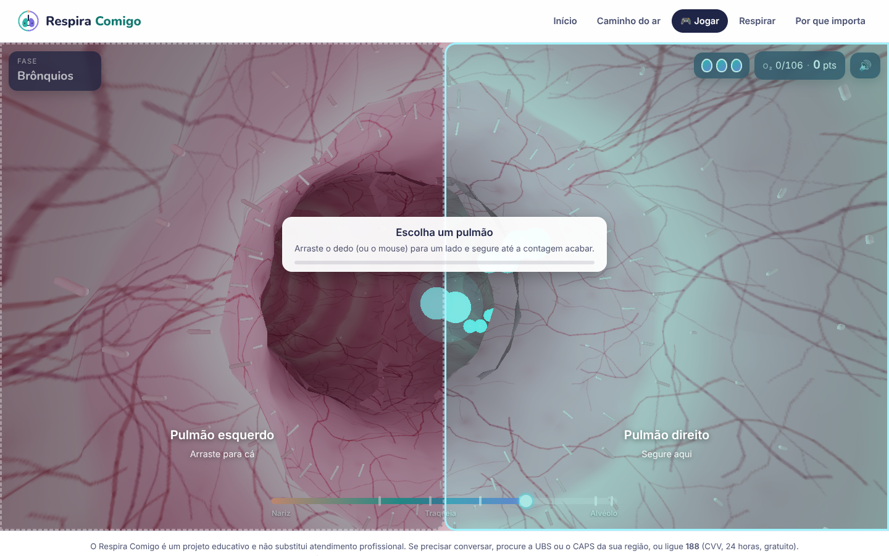 | 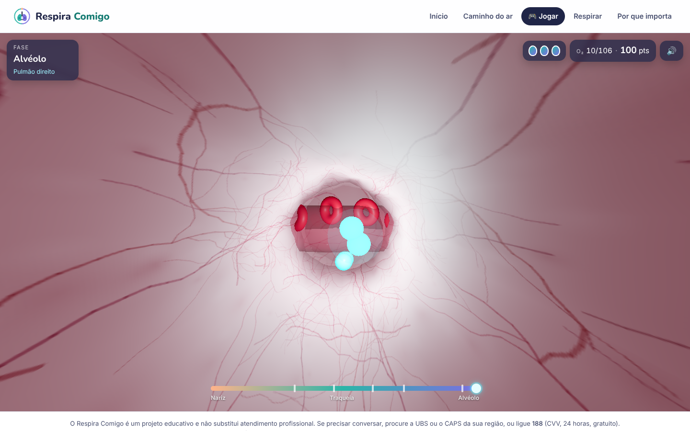 |
| **Respiração guiada** | **Desafio de ritmo** |
| 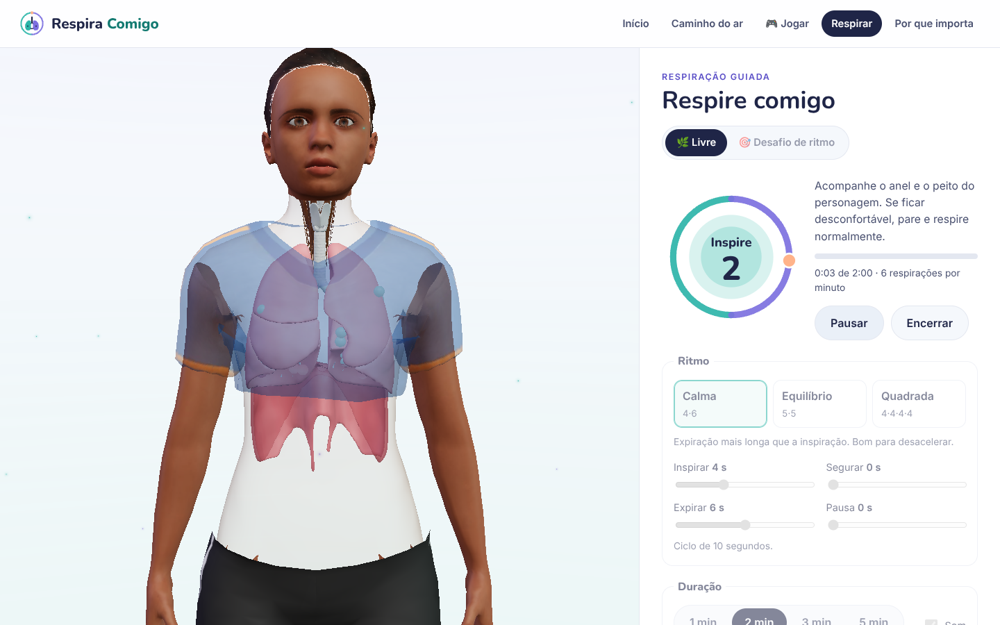 | 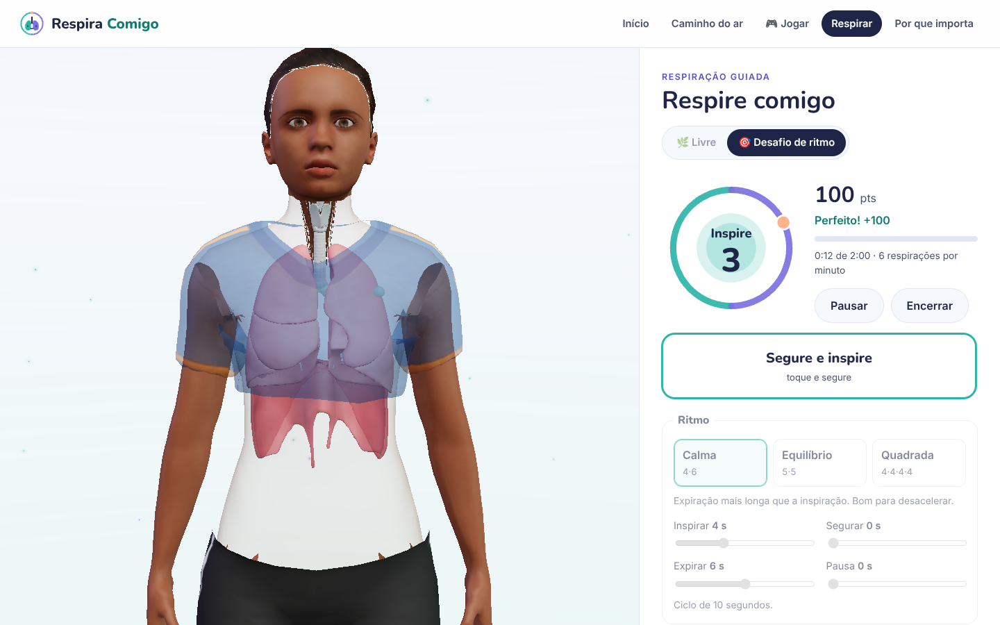 |

| Painel de dados | Celular | Celular: jogo |
|---|---|---|
| 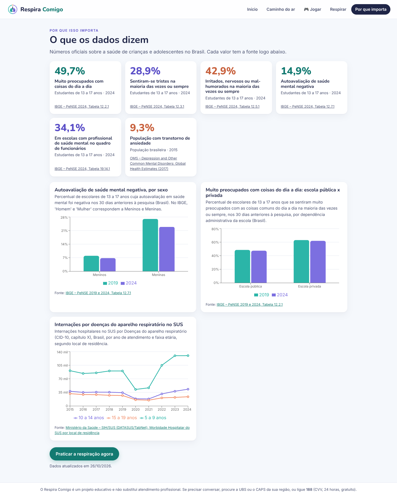 | 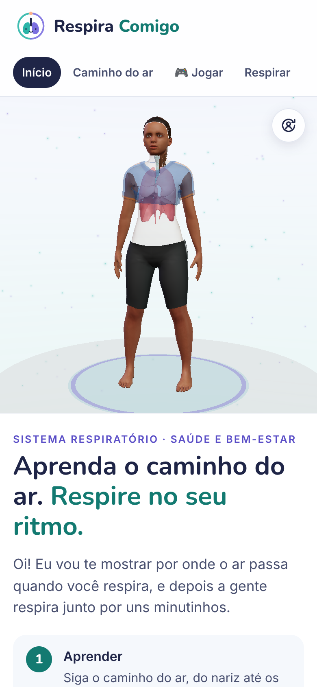 | 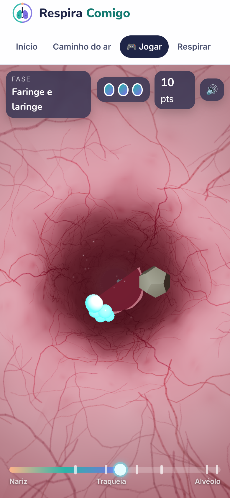 |

---

## 5. Como executar

**Online:** https://enzorossi11.github.io/respira-comigo/

**No computador** (requer [Node.js](https://nodejs.org/) 20 ou mais recente):

```bash
git clone https://github.com/enzorossi11/respira-comigo.git
cd respira-comigo/app
npm install
npm run dev
```

Depois, é só abrir o endereço que aparece no terminal (normalmente http://localhost:5173). Para rodar os testes, use `npm test`.

Os dados tratados já estão no repositório. Para baixá-los de novo das fontes oficiais (Python 3.10 ou mais recente):

```bash
pip install -r data/requirements.txt
python3 data/scripts/baixar_pense.py
python3 data/scripts/baixar_sih.py
python3 data/scripts/gerar_json.py
```

---

## 6. Tecnologias

| Camada | Tecnologia | Uso |
|---|---|---|
| Interface | React + TypeScript + Vite | Telas, navegação e controles |
| 3D | Three.js (React Three Fiber) | Personagem, órgãos, partículas de ar e jogo |
| Modelos 3D | MakeHuman (corpo) e Z-Anatomy (órgãos), preparados no Blender | Personagem personalizável com os órgãos do sistema respiratório |
| Gráficos | Recharts | Painel de dados |
| Dados | Python + pandas | Download e tratamento da PeNSE e do SIH/SUS |
| Testes | Vitest | Lógica da respiração, regras do jogo e pontuação |
| Publicação | GitHub Actions + GitHub Pages | Testa e publica o site a cada atualização |

**Justificativa das escolhas**

- **Aplicação web:** abre em qualquer computador da escola ou celular, sem instalação e sem cadastro.
- **3D no navegador:** o Three.js permite mostrar o corpo por dentro e animar a respiração sem exigir nenhum programa extra do aluno.
- **Modelos abertos:** o corpo vem do MakeHuman (licença CC0) e os órgãos do atlas Z-Anatomy (CC BY-SA 4.0). Assim o personagem é anatomicamente fiel sem precisar ser modelado do zero. Como cada aluno monta um corpo diferente, o app ajusta a posição e o tamanho dos órgãos ao tronco de cada personagem.
- **Sem servidor e sem dados pessoais:** os dados públicos são preparados com antecedência e lidos pelo app como um arquivo estático. As preferências e o personagem ficam só no navegador, então nenhum dado do aluno é coletado (LGPD).
- **Cuidado com o público:** por ser voltado a adolescentes, o app não exibe os indicadores da PeNSE sobre autolesão.
- **Acessibilidade:** navegação por teclado, rótulos para leitores de tela e contraste de texto adequado.

**Viabilidade no semestre:** a solução não depende de servidor, banco de dados ou serviços pagos, e a publicação é gratuita. As ferramentas e os modelos 3D são abertos, e as bases de dados são públicas. O escopo foi fechado num MVP pequeno (caminho do ar e respiração guiada), e o jogo e a personalização entraram como complementos.

---

## 7. Identidade visual

Guia completo: [`docs/identidade-visual.md`](docs/identidade-visual.md)

| Versão principal | Ícone | Fundo escuro |
|---|---|---|
|  | 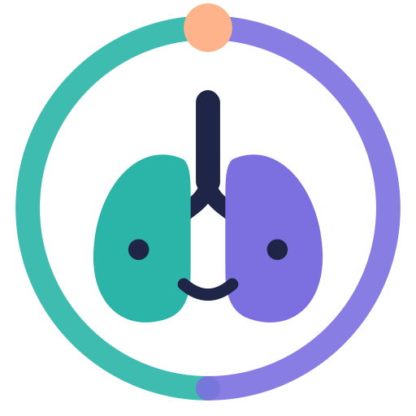 | 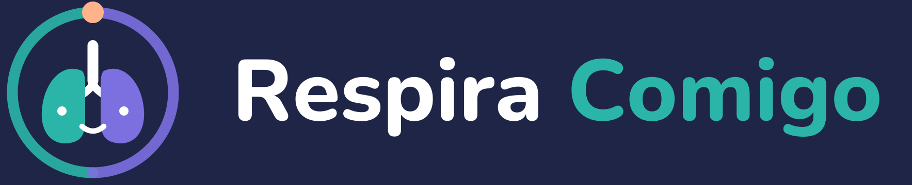 |

**Conceito:** dois pulmões com um rosto (o personagem) dentro de um anel de respiração. A metade verde do anel representa a inspiração, a metade lilás a expiração, e o ponto pêssego marca o ritmo. O mesmo anel guia a respiração dentro do app.

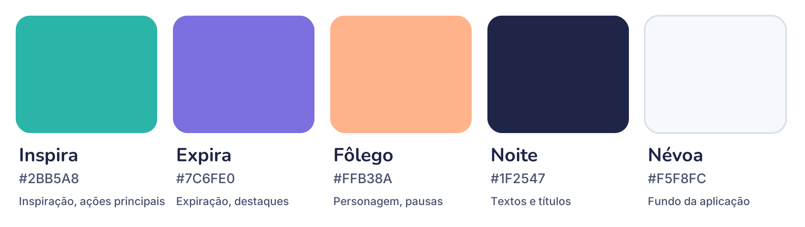

| Nome | HEX | Uso |
|---|---|---|
| Inspira | `#2BB5A8` | Inspiração |
| Inspira escuro | `#137A71` | Botões e textos em verde |
| Expira | `#7C6FE0` | Expiração |
| Fôlego | `#FFB38A` | Pausas, marcador de ritmo e destaques |
| Noite | `#1F2547` | Textos e títulos |
| Névoa | `#F5F8FC` | Fundo da aplicação |


**Tipografia:** Nunito ExtraBold nos títulos e Inter (Regular e SemiBold) nos textos.

---

## 8. Pitch

O Brasil é o país com maior prevalência de ansiedade do mundo, e metade dos estudantes de 13 a 17 anos diz se sentir muito preocupada com as coisas do dia a dia, mas só um terço estuda numa escola com profissional de saúde mental. A respiração é a forma mais simples de autorregulação, e mesmo assim a escola a ensina apenas como nomes de órgãos para decorar. O Respira Comigo muda isso: um personagem 3D mostra o caminho do ar do nariz aos alvéolos e, logo em seguida, respira junto com o aluno, no ritmo que ele escolher.

**Diferencial:** os apps de respiração não ensinam anatomia, e os materiais de Ciências não ensinam a respirar. O Respira Comigo junta as duas coisas numa experiência de poucos minutos, com um personagem criado pelo próprio aluno e um jogo que reforça o conteúdo. Roda no navegador, sem instalação e sem cadastro, e se baseia em dados públicos reais sobre a saúde dos estudantes brasileiros.

Pitch completo: [`docs/pitch.md`](docs/pitch.md)

---

## 9. Cronograma

| Período | Entrega |
|---|---|
| 19/10 a 30/10 | **Checkpoint 1:** problema, solução, identidade visual e pitch inicial |
| 09/11 a 13/11 | **Checkpoint 2:** protótipo funcional, repositório documentado e vídeo |
| 07/12 e 08/12 | **Apresentação final:** pitch de 5 minutos e projeto funcionando |

---

## 10. Estrutura do repositório

```
respira-comigo/
├── README.md
├── app/                  aplicação web (React + Three.js)
│   ├── public/modelos/   modelos 3D do personagem e dos órgãos
│   └── src/              telas, cena 3D, jogo e lógica da respiração
├── data/                 scripts e dados tratados (PeNSE e SIH/SUS)
│   └── modelo3d/         preparação dos modelos 3D e licenças
├── assets/               logo, paleta e tipografia
└── docs/
    ├── prints/           capturas de tela
    ├── demo.mp4          vídeo de demonstração
    ├── pitch.md
    ├── identidade-visual.md
    └── bases-de-dados.md
```

---

## 11. Equipe

| Integrante | RA |
|---|---|
| Enzo Rossi | 2025112797 |
| Mariane Paiva | 2026200252 |
| Maria Eduarda Morais | 2026220032 |
| Gleicy Crispim | 2026225830 |

---

## 12. Referências

- IBGE. **Pesquisa Nacional de Saúde do Escolar – PeNSE 2019** e **PeNSE 2024**. Rio de Janeiro: IBGE.
- Ministério da Saúde. **DATASUS – Sistema de Informações Hospitalares do SUS (SIH/SUS)**, TabNet.
- WORLD HEALTH ORGANIZATION. **Depression and Other Common Mental Disorders: Global Health Estimates**. Genebra: WHO, 2017.
- ZACCARO, A. et al. How breath-control can change your life: a systematic review on psycho-physiological correlates of slow breathing. **Frontiers in Human Neuroscience**, v. 12, 2018.
- ONU Brasil. **Objetivo de Desenvolvimento Sustentável 3 – Saúde e Bem-Estar**.
- MAKEHUMAN COMMUNITY. **MakeHuman** (assets de sistema, licença CC0 1.0). Disponível em: https://www.makehumancommunity.org/.
- KERVYN, G.; ZIELINSKI, M. **Z-Anatomy**: atlas 3D de anatomia humana, derivado do BodyParts3D (DBCLS). Licença CC BY-SA 4.0. Disponível em: https://github.com/Z-Anatomy/Models-of-human-anatomy. Os órgãos adaptados neste projeto (`app/public/modelos/orgaos.glb`) seguem a mesma licença.

---

<sub>O Respira Comigo é um projeto acadêmico de educação em saúde e não substitui avaliação ou tratamento profissional. Se precisar conversar, procure a UBS ou o CAPS da sua região, ou ligue para o CVV (188).</sub>
