<p align="center">
  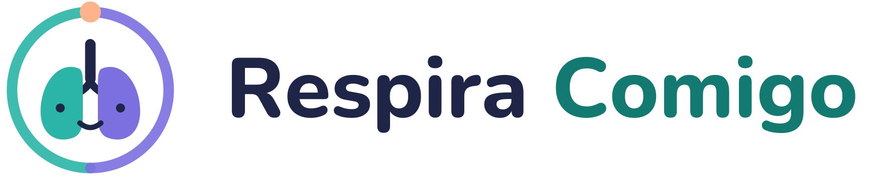
</p>

<p align="center"><b>Aprenda o caminho do ar. Viaje com ele. Respire com calma.</b></p>

<p align="center">
  
  
</p>

<p align="center">
  <a href="https://enzorossi11.github.io/respira-comigo/"><b>Abrir o app</b></a> ·
  <a href="docs/demo.mp4"><b>Vídeo de demonstração</b></a>
</p>

<p align="center">
  <a href="docs/demo.mp4">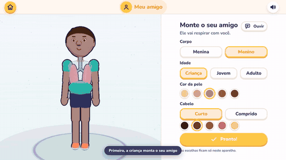</a>
</p>

---

## Sumário

1. [Sobre o projeto](#1-sobre-o-projeto)
2. [Descrição do problema](#2-descrição-do-problema)
3. [Solução](#3-solução)
4. [Design para crianças e autismo](#4-design-para-crianças-e-autismo)
5. [Protótipo](#5-protótipo)
6. [Como executar](#6-como-executar)
7. [Tecnologias](#7-tecnologias)
8. [Identidade visual](#8-identidade-visual)
9. [Pitch](#9-pitch)
10. [Cronograma](#10-cronograma)
11. [Estrutura do repositório](#11-estrutura-do-repositório)
12. [Equipe](#12-equipe)
13. [Referências](#13-referências)

---

## 1. Sobre o projeto

**Título:** Respira Comigo
**Tema:** Sistema respiratório · Saúde e Bem-Estar (ODS 3)
**Equipe:** Enzo Rossi, Mariane Paiva, Maria Eduarda Morais e Gleicy Crispim

O Respira Comigo é uma aplicação web em que um personagem 3D mostra o caminho que o ar percorre no corpo, do nariz até os alvéolos, e depois respira junto com a criança, num ritmo calmo. O conteúdo também vira uma viagem interativa, em que a criança guia o ar por dentro do corpo com o dedo ou o mouse.

O app foi pensado para ser usado por **crianças, inclusive crianças autistas**: telas previsíveis, poucas palavras, desenhos grandes, leitura em voz alta e nenhum tipo de pontuação, pressa ou erro.

**MVP:** caminho do ar em 8 paradas e respiração guiada com balão visual.

---

## 2. Descrição do problema

### 2.1 O problema

Adolescentes brasileiros convivem com níveis altos de ansiedade, preocupação e irritabilidade, e têm pouco apoio para lidar com isso dentro da escola. Ao mesmo tempo, a respiração, uma das formas mais simples de autorregulação, costuma ser ensinada apenas como conteúdo de prova, com nomes de órgãos para decorar e sem relação com o bem-estar do próprio aluno.

O aluno estuda o sistema respiratório, mas não aprende a usar a respiração a seu favor.

A lacuna é maior para crianças autistas: os materiais sobre o corpo costumam ser cheios de texto e as telas, cheias de estímulos, e quase nada é pensado para quem precisa de apoio visual, previsibilidade e calma para aprender e para se regular.

### 2.2 Dados

Os números abaixo foram extraídos das tabelas oficiais pelos scripts da pasta [`data/`](data/README.md) e também aparecem no app, com a fonte.

| Indicador (estudantes de 13 a 17 anos, Brasil) | 2024 | Fonte |
|---|---|---|
| Muito preocupados com as coisas comuns do dia a dia | **49,7%** | IBGE, PeNSE 2024, Tab. 12.2.1 |
| Irritados, nervosos ou mal-humorados por qualquer coisa | **42,9%** | IBGE, PeNSE 2024, Tab. 12.5.1 |
| Tristes na maioria das vezes ou sempre | **28,9%** | IBGE, PeNSE 2024, Tab. 12.3.1 |
| Autoavaliação de saúde mental negativa | **14,9%** (meninas 22,9%, meninos 6,8%) | IBGE, PeNSE 2024, Tab. 12.7.1 |
| Em escolas com profissional de saúde mental no quadro | **34,1%** | IBGE, PeNSE 2024, Tab. 19.14.1 |

Além disso, o Brasil tem a maior prevalência de transtornos de ansiedade do mundo, 9,3% da população (OMS, 2017), e as internações no SUS por doenças do aparelho respiratório entre crianças de 5 a 9 anos passaram de cerca de 90 mil em 2019 para cerca de 130 mil em 2024 (DATASUS, SIH/SUS).

### 2.3 Público e contexto

- **Público principal:** crianças, com atenção especial a crianças autistas (TEA). Para esse público, aprender o próprio corpo e ter uma forma concreta de se acalmar costuma depender de apoio visual, rotina previsível e ausência de sobrecarga sensorial, e é isso que a interface prioriza.
- **Público secundário:** pais, professores, terapeutas ocupacionais e acompanhantes terapêuticos, que usam o app junto com a criança. Para eles existe a área **Para adultos**, com os dados, orientações de uso e os ajustes finos da respiração.
- **Contexto de uso:** sala de aula, sala de recursos, sessões de terapia ou em casa, no tablet, celular ou computador, sempre que a criança precisar de um momento de calma.

### 2.4 Delimitação

O Respira Comigo não é tratamento e não substitui atendimento de saúde ou terapia. A proposta é de educação em saúde e autocuidado: ensinar como a respiração funciona e oferecer uma prática simples de respiração lenta. A área Para adultos indica onde buscar ajuda (UBS, CAPS e CVV 188).

### 2.5 Bases de dados públicas

| Base | Responsável | Uso no projeto |
|---|---|---|
| **PeNSE 2019 e 2024** | IBGE | Indicadores de saúde mental dos estudantes e presença de profissional de saúde mental na escola ([tabelas oficiais](https://ftp.ibge.gov.br/pense/)) |
| **SIH/SUS** | DATASUS / Ministério da Saúde | Internações por doenças do aparelho respiratório (CID-10, cap. X), de 5 a 19 anos, 2015 a 2024 ([TabNet](http://tabnet.datasus.gov.br/cgi/tabcgi.exe?sih/cnv/nrbr.def)) |
| **Global Health Estimates** | OMS | Prevalência de ansiedade no Brasil ([publicação](https://www.who.int/publications/i/item/depression-global-health-estimates)) |

Mais detalhes sobre as bases e as tabelas usadas: [`docs/bases-de-dados.md`](docs/bases-de-dados.md) e [`data/README.md`](data/README.md).

---

## 3. Solução

A tela inicial tem três cartões grandes, sempre na mesma ordem. Eles funcionam como uma agenda visual: o que a criança já fez ganha um ✓.

0. **Monte o seu amigo.** No primeiro acesso, a criança escolhe menina ou menino, criança, jovem ou adulto, cor da pele e cabelo, e o personagem muda na hora. Assim ela vê o caminho do ar num corpo parecido com o dela. As escolhas ficam salvas só no aparelho.
1. **Aprender: o caminho do ar.** Oito paradas, uma parte do corpo por vez: nariz, garganta, laringe, traqueia, brônquios, pulmões, alvéolos e diafragma. Em cada uma a câmera se aproxima, só aquela parte fica colorida e com contorno (o resto do corpo fica cinza-claro), e aparece uma frase curta, como "Os dois pulmões enchem de ar, como balões".
2. **Jogar: a viagem do ar.** A criança é o ar: entra pelo nariz do personagem e viaja até o pulmão, guiando com o dedo ou o mouse. No caminho aparecem pelos, poeira, pólen e a epiglote, para ela ver como o corpo é por dentro, mas encostar neles não tem consequência nenhuma. Não há pontos, vidas nem derrota: toda viagem termina com "Você chegou!".
3. **Respirar com o seu amigo.** Um balão cresce quando é hora de puxar o ar e diminui quando é hora de soltar, e os pulmões do personagem fazem o mesmo. A voz diz "Puxe o ar" e "Solte o ar" em cada fase. Bolinhas mostram quantas respirações faltam. Há três ritmos com desenho (Devagar, Igual e Quadrado), e no final a criança diz como está tocando numa carinha.
4. **Para adultos.** Painel com os dados oficiais que fundamentam o problema, orientações de uso e os créditos.

A escolha pela respiração lenta se apoia em estudos de revisão que associam a respiração controlada, em torno de 6 ciclos por minuto, a mais relaxamento e menos ansiedade (Zaccaro et al., 2018). Todos os ritmos prontos do app ficam nessa faixa.

---

## 4. Design para crianças e autismo

As decisões de interface seguem recomendações de acessibilidade cognitiva e de design para pessoas autistas, como as diretrizes de acessibilidade cognitiva do W3C (COGA) e os princípios do guia de design para autismo do governo britânico (Home Office Digital, 2016).

| Princípio | Como aparece no app |
|---|---|
| **Previsibilidade** | O mesmo topo em todas as telas: botão da casa à esquerda, nome da área no meio, som à direita. A tela inicial é sempre a mesma, com os três cartões na mesma ordem. |
| **Uma coisa por vez** | O caminho do ar mostra uma parte do corpo por vez, com uma frase. Os ajustes avançados ficam escondidos em "Ajustes para adultos". |
| **Apoio visual** | Cada área tem uma cor e um desenho próprios, que se repetem no cartão, no topo e nos botões (verde-água para Aprender, laranja para Jogar, lilás para Respirar, amarelo para a casa). Ícones desenhados para o app, iguais em qualquer aparelho. |
| **Pouco texto, linguagem literal** | Frases curtas e diretas ("O ar entra pelo nariz"), sem ironia nem expressões figuradas. |
| **Leitura em voz alta** | Todo bloco de texto tem o botão **Ouvir**, que lê em português com a voz do próprio aparelho, um pouco mais devagar. Na respiração e na viagem, a voz guia junto, se o som estiver ligado. |
| **Sem pressão** | Nada de pontuação, cronômetro, vidas ou derrota. O jogo é só a viagem, e encostar em obstáculos não tem efeito. Mensagens do jogo param a tela por 2 segundos para dar tempo de ler. |
| **Corpo sem realismo** | O personagem é um desenho animado, e os órgãos são formas simples (balões, tubos, galhos), sem pele, sangue ou detalhe anatômico que possa assustar. Por dentro, o jogo mostra um túnel rosa e liso. |
| **Conforto sensorial** | Nada pisca, nada treme, sem flash de "erro". Cores suaves, movimentos lentos e respeito à opção "reduzir movimento" do sistema. Som opcional, com um toque. |
| **Alvos grandes** | Botões com no mínimo 64 px de altura e letra arredondada (Nunito) em tamanho grande, fáceis de tocar e de ler. |
| **Expressar sentimentos** | No fim da respiração, a criança escolhe uma carinha (bem, mais ou menos, não muito bem) e recebe uma resposta acolhedora. Nada é registrado. |

---

## 5. Protótipo

[Vídeo de demonstração](docs/demo.mp4)

| Monte o seu amigo | Início: os três cartões |
|---|---|
| 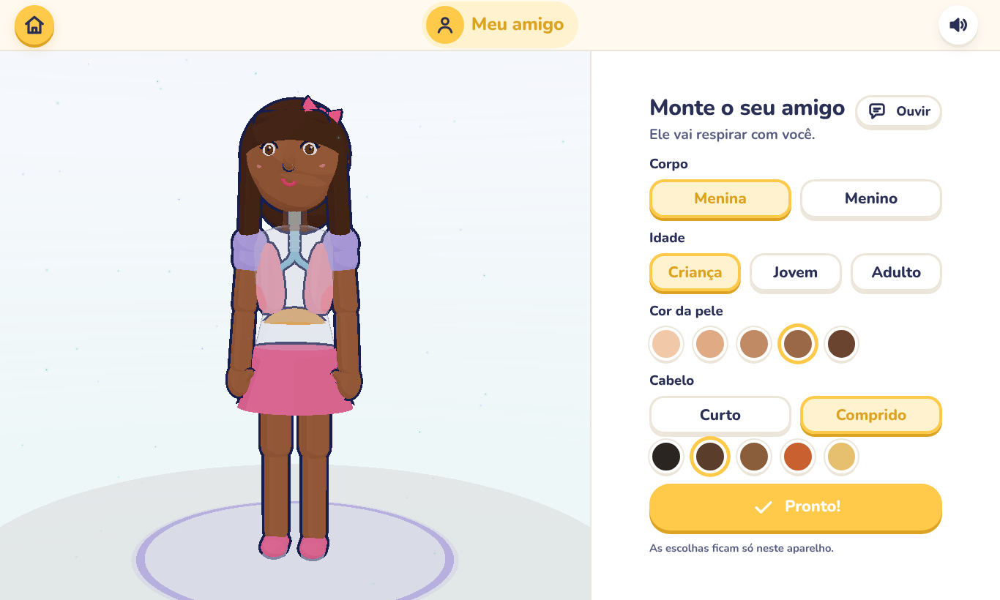 | 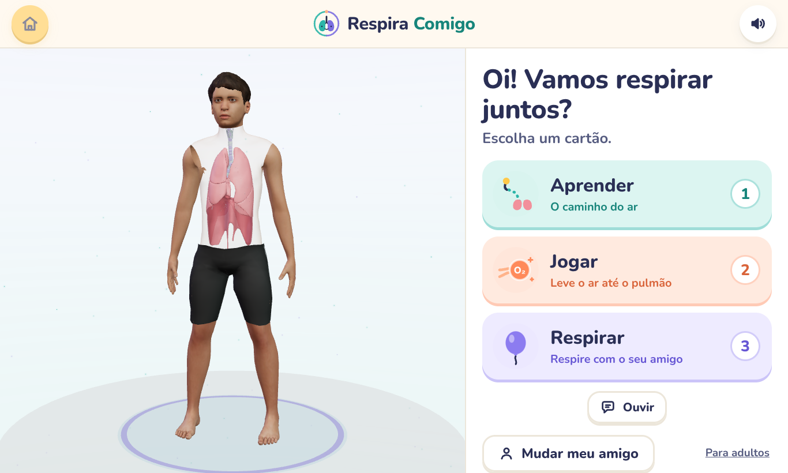 |
| **Aprender: uma parte por vez** | **Aprender: pulmões** |
| 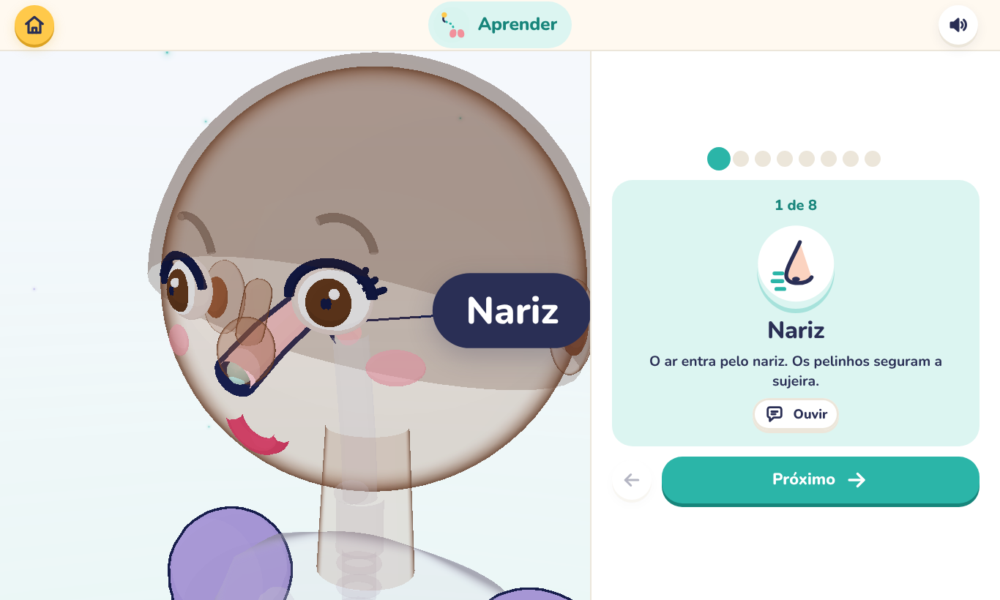 | 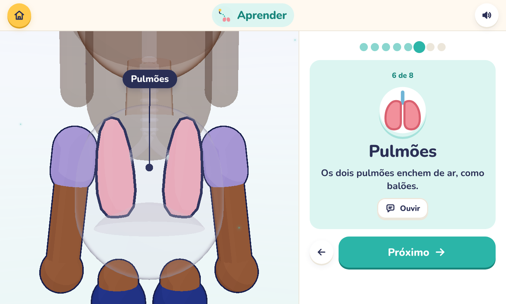 |
| **Fim do caminho do ar** | **Viagem do ar: começo** |
| 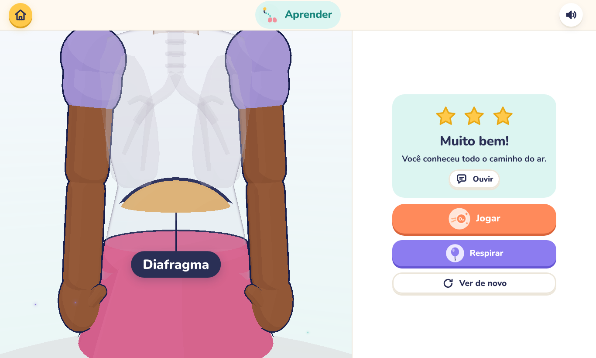 | 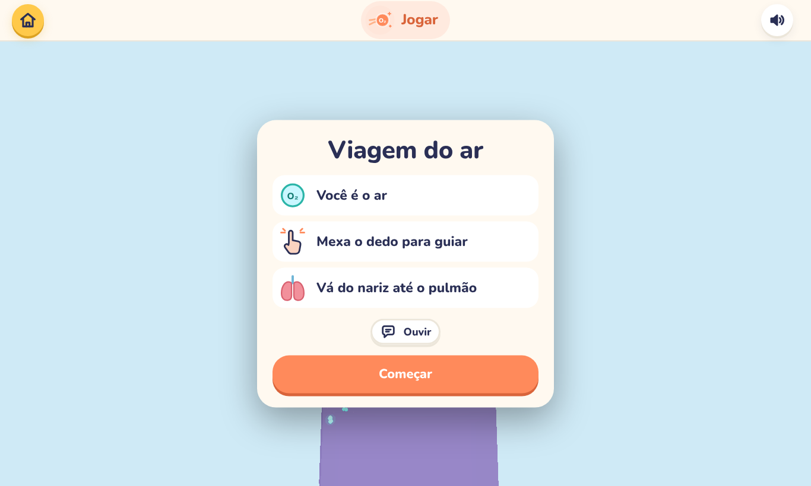 |
| **Viagem do ar: lá fora** | **Respirar** |
| 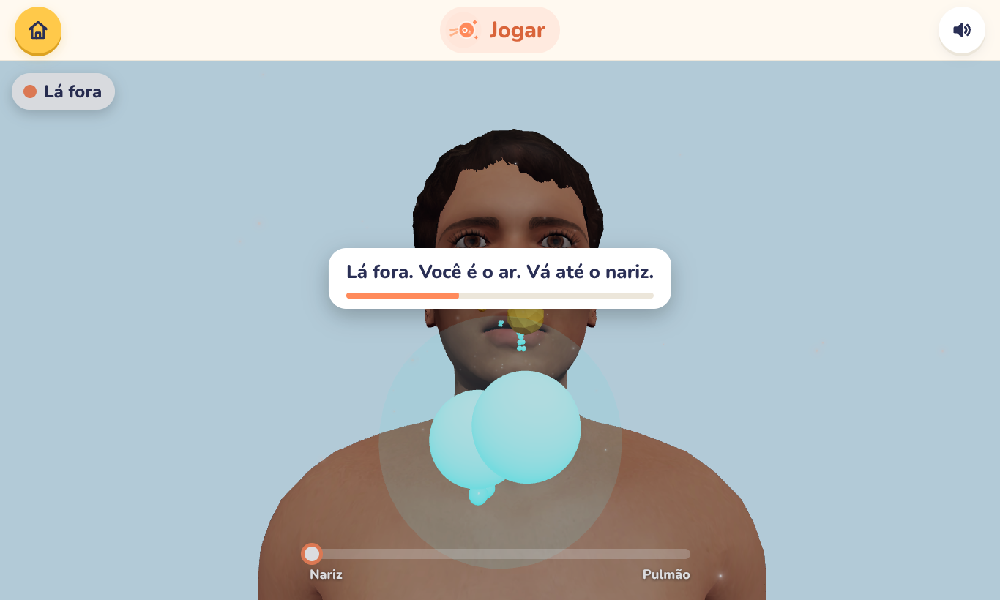 | 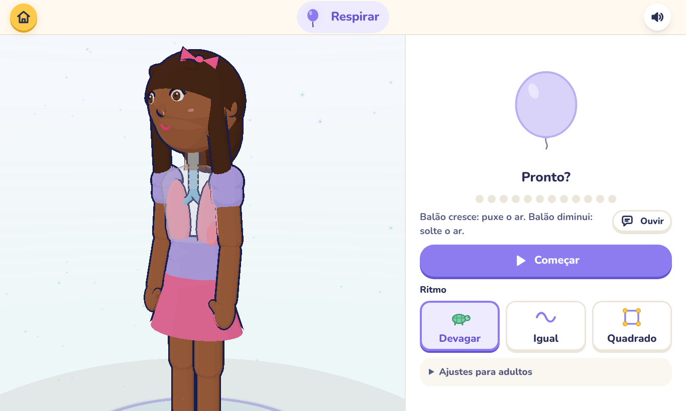 |
| **Puxe o ar** | **Agenda: o que já foi feito** |
| 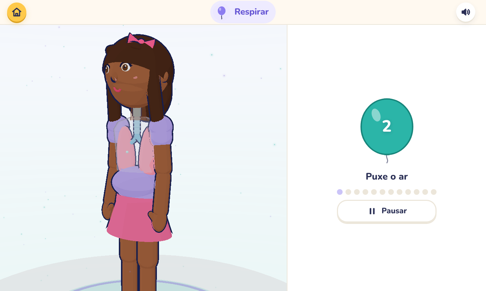 | 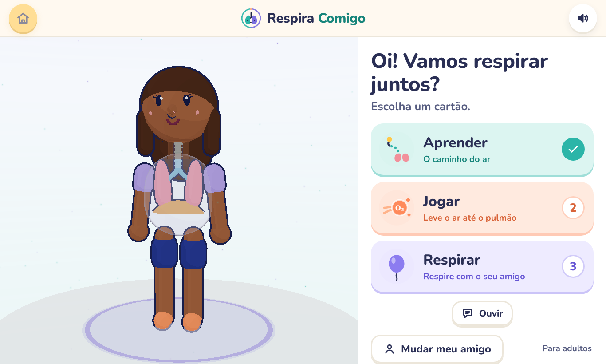 |

| Para adultos | Celular: início | Celular: aprender | Celular: respirar |
|---|---|---|---|
| 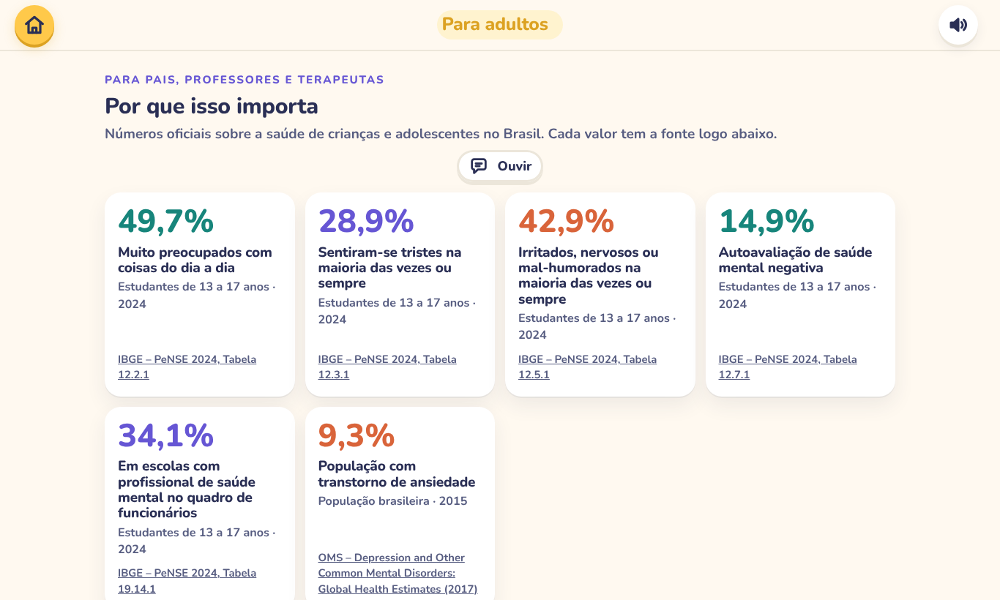 | 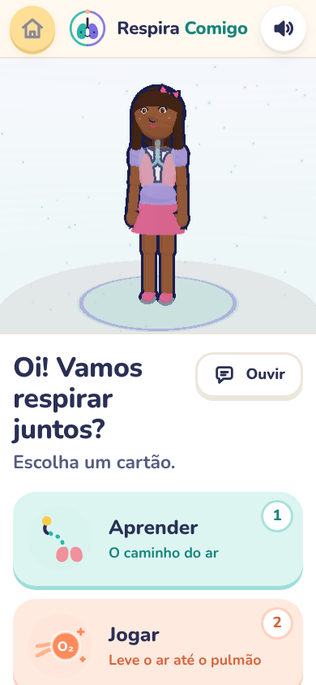 | 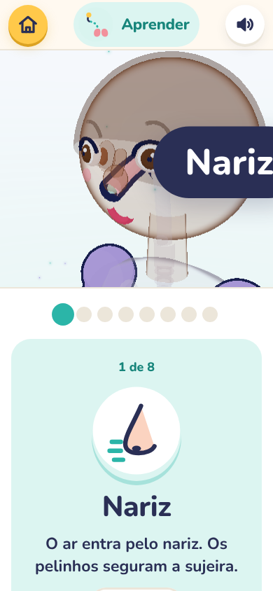 | 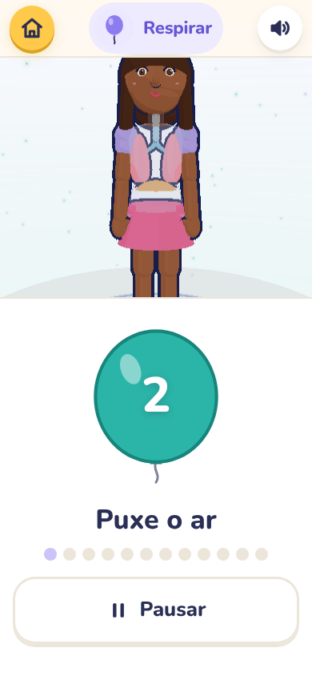 |

---

## 6. Como executar

**Online:** https://enzorossi11.github.io/respira-comigo/

**No computador** (requer [Node.js](https://nodejs.org/) 20 ou mais recente):

```bash
git clone https://github.com/enzorossi11/respira-comigo.git
cd respira-comigo/app
npm install
npm run dev
```

Depois, é só abrir o endereço que aparece no terminal (normalmente http://localhost:5173). Para rodar os testes, use `npm test`.

Os dados tratados já estão no repositório. Para baixá-los de novo das fontes oficiais (Python 3.10 ou mais recente):

```bash
pip install -r data/requirements.txt
python3 data/scripts/baixar_pense.py
python3 data/scripts/baixar_sih.py
python3 data/scripts/gerar_json.py
```

---

## 7. Tecnologias

| Camada | Tecnologia | Uso |
|---|---|---|
| Interface | React + TypeScript + Vite | Telas, navegação e controles |
| Voz | Web Speech API (voz do aparelho) | Botão Ouvir e voz guiando a respiração e a viagem |
| 3D | Three.js (React Three Fiber) | Personagem, órgãos, partículas de ar e jogo |
| Personagem 3D | Formas simples feitas em código, com sombreado de desenho (toon) e contorno | Personagem personalizável com os órgãos do sistema respiratório simplificados |
| Gráficos | Recharts | Painel de dados |
| Dados | Python + pandas | Download e tratamento da PeNSE e do SIH/SUS |
| Testes | Vitest | Lógica da respiração, regras da viagem e conteúdo |
| Publicação | GitHub Actions + GitHub Pages | Testa e publica o site a cada atualização |

**Justificativa das escolhas**

- **Aplicação web:** abre em qualquer computador da escola ou celular, sem instalação e sem cadastro.
- **3D no navegador:** o Three.js permite mostrar o corpo por dentro e animar a respiração sem exigir nenhum programa extra.
- **Personagem de desenho, feito em código:** em vez de um corpo humano realista, o amigo é um personagem de desenho animado (cabeça redonda, olhos grandes, roupa colorida), com os órgãos simplificados: pulmões como dois balões, traqueia como um tubo com anéis, brônquios como galhos. Isso evita imagens que possam assustar ou incomodar crianças, deixa o app leve (sem arquivos 3D para baixar) e permite mudar idade, pele e cabelo na hora.
- **Sem servidor e sem dados pessoais:** os dados públicos são preparados com antecedência e lidos pelo app como um arquivo estático. As preferências e o personagem ficam só no navegador, então nenhum dado da criança é coletado (LGPD).
- **Cuidado com o público:** por ser voltado a crianças, o app não exibe os indicadores da PeNSE sobre autolesão, e os dados ficam numa área separada, para adultos.
- **Acessibilidade:** leitura em voz alta em todas as telas, navegação por teclado, rótulos para leitores de tela, contraste de texto adequado e respeito à opção de reduzir movimento.
- **Voz sem internet e sem custo:** a leitura usa a voz já instalada no aparelho (Web Speech API), então funciona offline e não envia texto para nenhum serviço.

**Viabilidade no semestre:** a solução não depende de servidor, banco de dados ou serviços pagos, e a publicação é gratuita. As ferramentas são abertas, o personagem é feito em código e as bases de dados são públicas. O escopo foi fechado num MVP pequeno (caminho do ar e respiração guiada), e a viagem do ar e a personalização entraram como complementos.

---

## 8. Identidade visual

Guia completo: [`docs/identidade-visual.md`](docs/identidade-visual.md)

| Versão principal | Ícone | Fundo escuro |
|---|---|---|
|  | 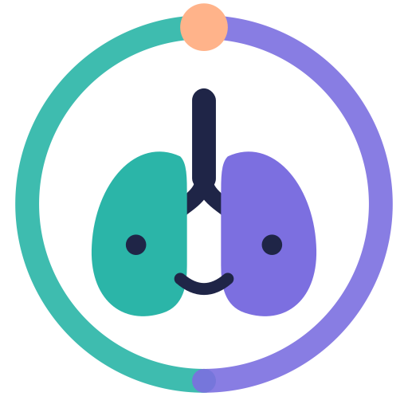 | 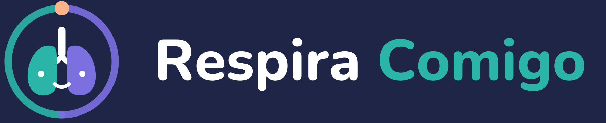 |

**Conceito:** dois pulmões com um rosto (o personagem) dentro de um anel de respiração. A metade verde do anel representa a inspiração, a metade lilás a expiração, e o ponto pêssego marca o ritmo. O mesmo anel guia a respiração dentro do app.

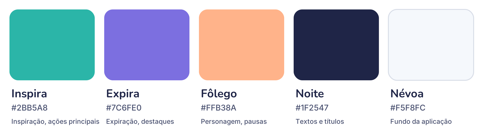

| Nome | HEX | Uso |
|---|---|---|
| Inspira | `#2BB5A8` | Inspiração |
| Inspira escuro | `#137A71` | Botões e textos em verde |
| Expira | `#7C6FE0` | Expiração |
| Fôlego | `#FFB38A` | Pausas, marcador de ritmo e destaques |
| Noite | `#1F2547` | Textos e títulos |
| Névoa | `#F5F8FC` | Fundo da aplicação |

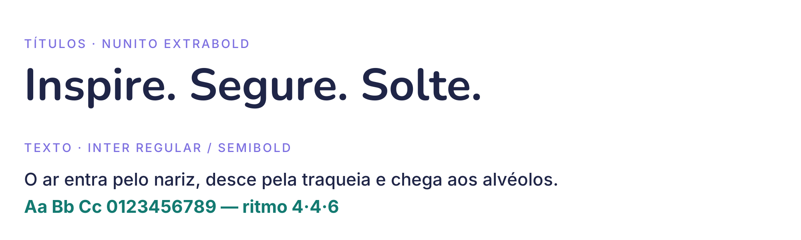

**Tipografia:** Nunito em todo o app (letra arredondada, fácil de ler), em tamanho grande.

**Cores por área.** Dentro do app, cada área tem uma cor fixa, para a criança se localizar pela cor:

| Área | Cor | HEX |
|---|---|---|
| Aprender | Verde-água | `#2BB5A8` |
| Jogar | Laranja | `#FF8A5B` |
| Respirar | Lilás | `#8C7CF0` |
| Casa (início) | Amarelo | `#FFC94A` |

---

## 9. Pitch

O Brasil é o país com maior prevalência de ansiedade do mundo, e metade dos estudantes de 13 a 17 anos diz se sentir muito preocupada com as coisas do dia a dia, mas só um terço estuda numa escola com profissional de saúde mental. A respiração é a forma mais simples de autorregulação, e mesmo assim a escola a ensina apenas como nomes de órgãos para decorar. O Respira Comigo muda isso: um personagem 3D mostra o caminho do ar do nariz aos alvéolos e, logo em seguida, respira junto com a criança. Tudo foi desenhado para que crianças autistas consigam usar sozinhas ou com um adulto: telas previsíveis, desenhos grandes, leitura em voz alta e nenhuma pontuação ou erro.

**Diferencial:** os apps de respiração não ensinam anatomia, e os materiais de Ciências não ensinam a respirar. O Respira Comigo junta as duas coisas numa experiência de poucos minutos, com um personagem criado pela própria criança e uma viagem interativa que reforça o conteúdo. Roda no navegador, sem instalação e sem cadastro, e se baseia em dados públicos reais sobre a saúde dos estudantes brasileiros.

Pitch completo: [`docs/pitch.md`](docs/pitch.md)

---

## 10. Cronograma

| Período | Entrega |
|---|---|
| 19/10 a 30/10 | **Checkpoint 1:** problema, solução, identidade visual e pitch inicial |
| 09/11 a 13/11 | **Checkpoint 2:** protótipo funcional, repositório documentado e vídeo |
| 07/12 e 08/12 | **Apresentação final:** pitch de 5 minutos e projeto funcionando |

---

## 11. Estrutura do repositório

```
respira-comigo/
├── README.md
├── app/                  aplicação web (React + Three.js)
│   └── src/              telas, cena 3D, jogo e lógica da respiração
├── data/                 scripts e dados tratados (PeNSE e SIH/SUS)
├── assets/               logo, paleta e tipografia
└── docs/
    ├── prints/           capturas de tela
    ├── demo.mp4          vídeo de demonstração
    ├── pitch.md
    ├── identidade-visual.md
    └── bases-de-dados.md
```

---

## 12. Equipe

| Integrante | RA |
|---|---|
| Enzo Rossi | 2025112797 |
| Mariane Paiva | 2026200252 |
| Maria Eduarda Morais | 2026220032 |
| Gleicy Crispim | 2026225830 |

---

## 13. Referências

- IBGE. **Pesquisa Nacional de Saúde do Escolar – PeNSE 2019** e **PeNSE 2024**. Rio de Janeiro: IBGE.
- Ministério da Saúde. **DATASUS – Sistema de Informações Hospitalares do SUS (SIH/SUS)**, TabNet.
- WORLD HEALTH ORGANIZATION. **Depression and Other Common Mental Disorders: Global Health Estimates**. Genebra: WHO, 2017.
- ZACCARO, A. et al. How breath-control can change your life: a systematic review on psycho-physiological correlates of slow breathing. **Frontiers in Human Neuroscience**, v. 12, 2018.
- ONU Brasil. **Objetivo de Desenvolvimento Sustentável 3 – Saúde e Bem-Estar**.
- W3C. **Making Content Usable for People with Cognitive and Learning Disabilities** (COGA). W3C Working Group Note, 2021. Disponível em: https://www.w3.org/TR/coga-usable/.
- HOME OFFICE DIGITAL (Reino Unido). **Dos and don'ts on designing for accessibility**: pôster sobre usuários no espectro autista, 2016. Disponível em: https://accessibility.blog.gov.uk/2016/09/02/dos-and-donts-on-designing-for-accessibility/.

---

<sub>O Respira Comigo é um projeto acadêmico de educação em saúde e não substitui avaliação ou tratamento profissional. Se precisar conversar, procure a UBS ou o CAPS da sua região, ou ligue para o CVV (188).</sub>
