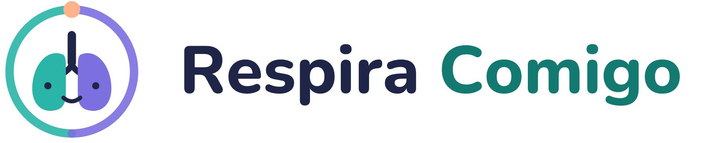
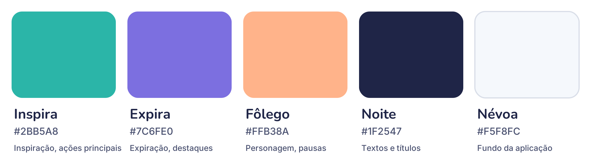
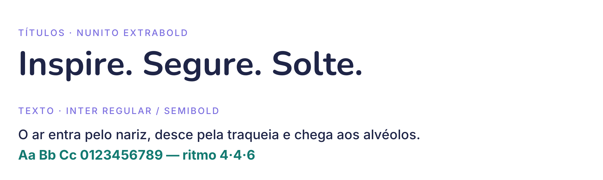

# Identidade visual – Respira Comigo



## Conceito

**Calmo, acolhedor e claro.** O app fala com adolescentes sobre algo que pode ser difícil (ansiedade), então a marca evita tons de alerta e visual “hospitalar”. As cores representam as fases da respiração e o personagem tem formas arredondadas e expressão tranquila.

## Logo

O símbolo junta três ideias:

1. **Pulmões com rosto** → o personagem que respira com você.
2. **Anel de respiração** → metade verde (inspira) e metade lilás (expira): o ciclo completo.
3. **Ponto pêssego no topo** → o marcador de ritmo, o mesmo que percorre o anel na tela de respiração guiada.

### Versões

| Arquivo | Quando usar |
|---|---|
| `assets/logo/logo-horizontal.svg/.png` | Versão principal: README, slides, cabeçalho do app |
| `assets/logo/logo-vertical.svg/.png` | Espaços quadrados: capa, tela de abertura |
| `assets/logo/icone.svg/.png` | Favicon, ícone do app, avatar do repositório |
| `assets/logo/logo-horizontal-negativo.svg/.png` | Fundos escuros (cor Noite) |
| `assets/logo/icone-mono.svg/.png` | Impressão em uma cor |

O texto do logo está convertido em curvas nos SVGs, então o arquivo aparece igual em qualquer computador.

### Cuidados

- Manter área livre ao redor do logo de pelo menos a altura do ponto pêssego × 2.
- Não distorcer, girar, trocar as cores ou aplicar sombra.
- Tamanho mínimo do ícone: 24 px.

## Paleta



| Nome | HEX | RGB | Uso |
|---|---|---|---|
| Inspira | `#2BB5A8` | 43, 181, 168 | Inspiração, botões primários |
| Inspira escuro | `#137A71` | 19, 122, 113 | Texto verde sobre fundo claro |
| Expira | `#7C6FE0` | 124, 111, 224 | Expiração, destaques, estado ativo |
| Fôlego | `#FFB38A` | 255, 179, 138 | Personagem, pausas (“segure”), marcador de ritmo |
| Noite | `#1F2547` | 31, 37, 71 | Textos, títulos, fundo do modo escuro |
| Névoa | `#F5F8FC` | 245, 248, 252 | Fundo principal |

**Regra de acessibilidade:** texto sempre em **Noite** ou **Inspira escuro** sobre fundo claro, ou em branco sobre **Noite**. Inspira, Expira e Fôlego são para formas, ícones e estados, não para texto pequeno.

**Cores na respiração guiada:** inspirar = Inspira · segurar = Fôlego · expirar = Expira. A mesma lógica vale para as partículas de ar no modelo 3D.

### Tokens CSS (para o código do Checkpoint 2)

```css
:root {
  --rc-inspira: #2BB5A8;
  --rc-inspira-escuro: #137A71;
  --rc-expira: #7C6FE0;
  --rc-folego: #FFB38A;
  --rc-noite: #1F2547;
  --rc-nevoa: #F5F8FC;

  --rc-font-titulo: "Nunito", system-ui, sans-serif;
  --rc-font-texto: "Inter", system-ui, sans-serif;
  --rc-raio: 16px;
}
```

## Tipografia



| Papel | Fonte | Peso | Tamanhos sugeridos |
|---|---|---|---|
| Títulos | Nunito | ExtraBold (800) | 32–48 px |
| Subtítulos | Nunito | Bold (700) | 20–24 px |
| Texto | Inter | Regular (400) | 16–18 px |
| Botões e rótulos | Inter | SemiBold (600) | 14–16 px |
| Contador da respiração | Nunito | ExtraBold (800) | 64–96 px |

Ambas estão no Google Fonts (licença OFL, uso livre):

```html
<link href="https://fonts.googleapis.com/css2?family=Inter:wght@400;600&family=Nunito:wght@700;800&display=swap" rel="stylesheet">
```

## Interface para crianças

No app, a identidade foi adaptada para crianças, inclusive crianças autistas:

- **Uma cor por área**, sempre a mesma: Aprender em verde-água `#2BB5A8`, Jogar em laranja `#FF8A5B`, Respirar em lilás `#8C7CF0` e a casa (início) em amarelo `#FFC94A`. Cada cor tem uma versão escura para sombras e textos e uma clara para fundos.
- **Fundo creme** `#FFF9F0` e texto em `#2A2F55`, com contraste alto e sem branco puro ofuscante.
- **Nunito em tudo**, inclusive nos textos, a partir de 19 px. A letra arredondada fica mais amigável e fácil de ler do que a Inter nesse público.
- **Ícones próprios em SVG**, com traço grosso e cantos redondos, para ficarem iguais em qualquer aparelho (emojis mudam de um sistema para outro).
- **Botões grandes** (64 px ou mais) com uma "base" mais escura embaixo, que afunda ao tocar, para o toque ser fácil de ver e de sentir.
- **Nada pisca ou treme.** Animações curtas e lentas, desligadas quando o sistema pede menos movimento.

## Tom de voz

- Fala direto com a criança, no “você”, com frases curtas e literais (sem ironia nem expressões figuradas).
- Convida, não manda: “Vamos respirar juntos?” em vez de “Respire agora”.
- Nunca promete curar nada. Usa “pode ajudar a se acalmar”.
